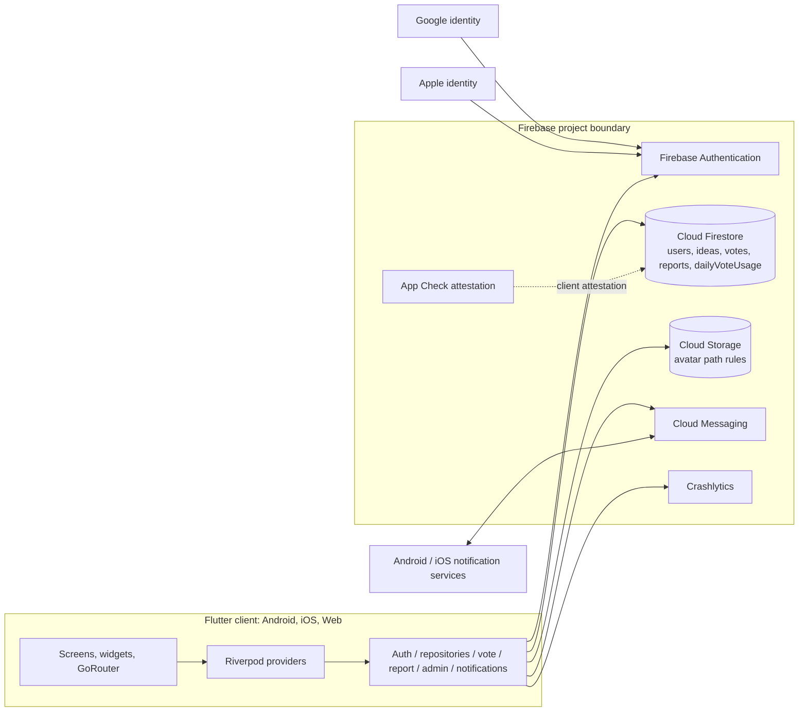

# Application Overview & Security Assessment Brief

**Application:** Dumb or Genius  
**Maintainer:** Kounga Solutions  
**Review type:** Repository-based technical discovery  
**Review date:** 17 October 2026  
**Scope note:** This document describes evidence in the checked-out repository. It is not a penetration test, vulnerability assessment, compliance certification, or complete security audit. No production systems were accessed and no tests or security probes were run.

## 1. Executive Application Overview

Dumb or Genius is a social idea-sharing mobile application. Users post short ideas into one of two themed communities (“Genius” and “Dumb”), and other users vote on them. The app adds profiles, rankings, leaderboards, reporting, blocking, and a lightweight moderation workflow. Browsing is available without signing in; posting, voting, reporting, and profile actions use an account.

The product addresses a lightweight community engagement use case: publishing ideas, collecting feedback, and managing user-generated content. Intended users are members of the public using Android, iOS, and a web build (the web route includes an admin moderation panel). No customer/enterprise tenant model is visible in the code.

The application appears to be an MVP or early release candidate: package version is `1.0.0+3`, the README describes a Firebase Spark-plan MVP, and store-readiness/legal documents contain outstanding pre-release tasks and draft content. This is a repository-based inference; live release status cannot be established.

| Area | Observed |
|---|---|
| Client | Flutter / Dart, Riverpod state management, GoRouter navigation |
| Backend | Firebase Authentication and Cloud Firestore; Firebase Storage rules are present for avatar objects |
| Other Firebase SDKs | App Check, Crashlytics, Analytics, Remote Config and Cloud Messaging dependencies are declared; repository code directly wires App Check, Crashlytics and Messaging. Analytics and Remote Config usage is not identifiable in the inspected app code. |
| Sign-in | Google, Apple and email/password flows appear in `AuthService` and login UI |
| Hosting/deployment | Android and iOS project configuration is present; a Flutter web build and Firebase rules/index deployment setup are described. No hosting configuration or CI/CD pipeline is present in the repository. |
| Backend compute | No Cloud Functions or application server source identified. The README says the app runs on Firebase Spark with no Cloud Functions. |
| External services | Firebase services; Google and Apple identity; Google Fonts package; platform push services through Firebase Messaging. |

The client communicates directly with Firebase. Firestore Security Rules are central to access control and data integrity. A client-side App Check activation selects Play Integrity / DeviceCheck in release builds and debug providers otherwise, but Firebase enforcement and console configuration are outside repository evidence.

## 2. Application Functionality

| Feature | User interaction and business purpose | Backend/data effects | External services |
|---|---|---|---|
| Browse feeds and trending | Guests and signed-in users browse either world, sort by latest, trending or top, and open idea details. | Reads public `ideas`; trending score is calculated in Dart and stored with idea updates. Queries use pagination and Firestore indexes. Blocked and self-reported ideas are filtered client-side for the current user. | Cloud Firestore |
| Create and manage ideas | Signed-in user submits title/description, can hide, restore or soft-delete their own idea. | Transaction creates an idea and increments profile count; rules limit text lengths and check slots. Idea content, author UID/name/avatar snapshot, timestamps, status and counters are stored. | Cloud Firestore |
| Vote and ranks | User votes or undoes a vote; daily allowance is tracked separately per world. Votes contribute to author totals and milestones. | A Firestore transaction writes/deletes a deterministic vote record, changes idea count/hot score, updates daily usage and author tally/slot count. Rules constrain several deltas and ownership checks. | Cloud Firestore |
| Profiles and leaderboards | User selects avatars, edits display name, views stats and public profiles. | Public `users/{uid}` profile fields and per-world vote/idea counters; leaderboard query orders users by received vote count. | Cloud Firestore, Firebase Storage rules for avatar path (no upload flow was confirmed in inspected core services) |
| Report and block | Signed-in user selects a report category and optional note, or blocks another user. Reported ideas disappear from that reporter’s own feed. | `reports` document plus idea report count/status; private per-user `blocks` subcollection. Filtering is client-side. | Cloud Firestore |
| Moderation | Admin web panel displays report, hidden-idea and reported-idea queues; admin can hide, release or remove and strike an author. | Admin writes to idea status and user strike/ban fields; rules use the caller’s profile `isAdmin` flag. | Cloud Firestore; browser/web build |
| Account and login | Login/register via Google, Apple or email/password; profile deletion anonymizes public profile then deletes Firebase Auth user. | Firebase Auth identity; public profile retained with anonymized name/avatar. Existing ideas and vote history are intentionally retained per code/docs. | Firebase Auth, Google/Apple identity |
| Push notifications | Permission request, foreground display, background handler, token registration and removal. | Device token saved under owner’s `users/{uid}/fcmTokens`; no server-side send implementation identified. | Firebase Cloud Messaging / OS push services |

## 3. Technical Architecture

**Trust boundaries and flows:** The end-user device is a client-controlled trust zone. Authentication establishes Firebase identity; Firestore Rules use `request.auth` and document state to authorize direct client operations. App Check is initialized by the client, but whether enforcement is enabled for each Firebase product is configuration-dependent. Firebase services form the managed backend boundary. Google/Apple identity providers and platform notification infrastructure are external boundaries. Public profile and idea reads cross user boundaries; report details and block lists are more restricted by rules.

There is no server-owned application API or Cloud Functions layer evident. That is material to the trust model: several business workflows are implemented as client transactions and rely on Firestore rules to constrain writes. Indexes for feed and leaderboard access are declared in `firestore.indexes.json`.

## 4. Data Classification and Handling

| Category | Examples and origin | Processing/storage and exposure |
|---|---|---|
| Public user/profile data | Display name, selected avatars, public vote totals, idea/slot counts; supplied or generated by user/app | `users/{uid}` is readable by anyone under `firestore.rules`; used in profiles and leaderboards. Account deletion sets display name to “Deleted user” and clears avatar fields but retains profile history. |
| Account identifiers | Firebase UID; email/display name from sign-in providers | Firebase Auth handles credentials; app uses UID for document ownership. Email is not visibly copied into Firestore by profile model. Provider-side and Firebase retention/configuration are not established. |
| User-generated content | Idea title/description and report reason/note | Firestore `ideas` and `reports`. Ideas are publicly readable. Report records are readable by reporter and admin per rules. User content can include personal/sensitive information even though the product does not request it. |
| Activity and reputation | Votes, daily usage, idea status/counts, strikes and ban flags | Firestore collections/documents; public idea and profile counters, private per-user vote-usage reads and reporter-scoped reports. Moderation fields are admin managed in app code/rules. |
| Device/push data | FCM token, platform label, update timestamp | Owner-private Firestore token subcollection according to rules; token refresh writes are registered by client. Retention beyond explicit unregister/account lifecycle is not established. |
| Diagnostics/telemetry | Uncaught exception and crash details; Firebase Analytics package is declared | Crashlytics is initialized on non-web platforms in `main.dart`; Analytics is in dependencies and privacy docs, but a direct analytics call was not identified. Provider retention/configuration unknown. |
| Avatar media | Avatar object path under `avatars/{uid}/{fileName}` | Storage rules allow public reads and owner writes for image content under 5 MiB. The inspected app data model primarily uses bundled avatar IDs; actual upload use was not confirmed. |
| Financial / sensitive special-category data | No payment feature, financial record, or intentionally collected sensitive category identified | Unknown whether user-generated text contains such information. No AI prompt/conversation or AI/ML integration identified. |

**Data minimisation and deletion:** Idea title/description lengths are constrained in rules and UI; reports have a 200-character rule limit. Profile deletion anonymizes rather than deleting public contributions; votes, ideas, reports, FCM tokens, blocks and other related records are not visibly comprehensively purged by the deletion flow. Account deletion ordering and failure behavior merit lifecycle verification. Firestore/Storage retention, backup expiry, regional location and provider deletion policies are not in repository evidence.

## 5. Existing Security Architecture and Controls

| Security area | Observed implementation | Evidence / source location | Verification status |
|---|---|---|---|
| Authentication | Firebase Auth with Google, Apple, and email/password flows; account state stream drives the app. | `lib/services/auth_service.dart`, `lib/screens/login_screen.dart` | Confirmed in source; provider enablement and production behavior configuration-dependent |
| Session and MFA | Firebase SDK manages session; no explicit MFA enrollment or step-up flow identified. Account deletion handles Firebase `requires-recent-login`. | `AuthService.deleteAccount`; `firestore.rules` | Not identifiable from repository for MFA; session behavior requires runtime/provider verification |
| Authorization | Firestore rules check signed-in UID, profile ownership, admin flag, and allowed field deltas. Admin access is also checked in UI, with rules expected to enforce writes. | `firestore.rules`; `lib/admin/admin_screen.dart`; `lib/services/admin_service.dart` | Confirmed in source; production deployment of rules requires runtime verification |
| Public/private boundaries | Profiles and ideas public-readable; user blocks and FCM token docs restricted to owner; reports readable to reporter/admin. | `firestore.rules` | Confirmed in source; requires deployed-rules verification |
| Tenant isolation | No multi-tenant/customer tenant model is evident. Per-user ownership is used for selected collections. | Firestore schema/rules, repositories | Not identifiable as applicable |
| Input validation | UI checks required fields and profanity; rules check idea title/description nonempty/length/world/status/initial counters and report reason length. Rules constrain field sets/deltas for some updates. | `CreateIdeaScreen`, `ProfanityFilter`, `firestore.rules` | Confirmed in source; client filter is bypassable by design and is not a server content moderation service |
| Vote integrity | Deterministic vote IDs, no self-vote on vote creation, immutable vote docs, signed-in owner delete; transaction coordinates counters. Rule deltas constrain count changes. | `VoteService`, `firestore.rules`, `Vote.docId` | Confirmed in source; full cross-document invariants and abuse resistance require runtime assessment |
| Content moderation integrity | Rules limit report count change to +1, status auto-hide threshold conditions, admin update paths; app client decides when to include hidden status. | `ReportService`, `AdminService`, `firestore.rules` | Confirmed in source, with important caveat: rules do not bind a report-count increment to creation of a corresponding report document or validate that status transition is performed only by an admin beyond the declared conditions. Effective moderation integrity requires dedicated review. No vulnerability conclusion is made here. |
| Account deletion | Anonymizes profile then deletes Firebase Auth account; recent-login error causes sign-out and message. | `UserRepository.disableProfile`, `AuthService.deleteAccount`, `profile_tab.dart` | Confirmed in source; deletion completeness and partial-failure handling require runtime verification |
| Storage | Public avatar reads; authenticated owner writes only to own path, image MIME pattern and <5 MiB; deny-all fallback. | `storage.rules` | Confirmed in source; deployed state, MIME/content validation and object lifecycle require runtime verification |
| Transport/encryption | Firebase SDK services normally use provider-managed transport; iOS declares non-exempt encryption false. No custom backend TLS configuration exists. | Platform configuration, `ios/Runner/Info.plist` | Configuration/provider-dependent; production transport and encryption-at-rest settings are not established here |
| Secrets/configuration | Firebase client configuration files are present; Android signing properties file exists locally and example is present. No service-account credential file surfaced in tracked source listing. A sensitive Apple signing-key file is present in repository tree. | `android/app/google-services.json`, `ios/Runner/GoogleService-Info.plist`, `android/key.properties`, `ios/AuthKey_*.p8` | Sensitive categories noted only; no values reproduced. Repository history, distribution, revocation and key custody require owner review. Firebase client config is not treated as a server secret. |
| App Check | Client activates Play Integrity / DeviceCheck for release, debug provider for debug builds. | `lib/main.dart` | Confirmed client configuration; enforcement and registered app settings are configuration-dependent |
| CORS/headers/rate limits/request size | No custom HTTP API/server or web security header configuration identified. Firestore rules and Storage size constraints are present. | `firebase.json`, `storage.rules` | Not identifiable from repository for HTTP controls; service quotas and abuse protections require runtime verification |
| Error handling | Flutter uncaught errors and platform errors forwarded to Crashlytics on non-web; user-facing operations display caught error strings in some UI flows. | `lib/main.dart`, screens/services | Confirmed in source; data redaction and production diagnostics settings require runtime verification |
| Audit and monitoring | Crashlytics integration; no dedicated security audit event pipeline or alert definitions identified. | `main.dart`, Firebase config | Not identifiable from repository; console monitoring/alerts unknown |
| Dependency management | Dart dependencies are version constrained and lockfile exists; npm lockfiles exist for seed/tests. No automated vulnerability scanning/update configuration found. | `pubspec.yaml`, `pubspec.lock`, `seed/package-lock.json`, `firestore-tests/package.json` | Confirmed files; scan/update practice not identifiable |
| Security tests | Firestore rules unit tests use Firebase Rules Unit Testing and test identity, ownership, deltas and moderation rules. README documents emulator invocation. | `firestore-tests/rules.test.js`, `firestore-tests/package.json` | Documentation and source evidence; tests not run in this review and test completeness unknown |
| CI/CD and release checks | No CI workflow or automated security scan/release gate identified. Android release falls back to debug signing if local signing properties are absent. | `android/app/build.gradle.kts`; repository file inventory | Confirmed source behavior; real release signing pipeline not identifiable |

## 6. Current Security Development Practices

**Evidence in repository:** Firestore rules centralize selected authorization and integrity checks; Firestore unit tests cover numerous allow/deny cases; dependency lockfiles are checked in; Flutter lint configuration exists; store-readiness and social-login setup documents call out manual release work. Comments and developer guides document some security assumptions and operational constraints.

**Not established:** No threat model, formal security requirements, code review policy, CI/CD definition, automated SAST/DAST/dependency scanning configuration, release security checklist execution record, vulnerability intake/remediation workflow, risk acceptance register, incident response plan, or security event monitoring runbook was identified. Their absence from the repository does not prove such practices do not exist outside it.

The privacy policy and terms are explicitly draft templates with placeholders and the store-readiness document calls out hosting, App Store / Play Console declarations, and platform manifest target membership as outstanding checks. This is documentation evidence, not a legal or compliance conclusion.

## 7. Security Assurance Coverage and Unknowns

**Implementation evidence exists** for Firebase Auth integration, Firestore rules, owner-scoped block/token storage, storage path restrictions, client App Check activation, basic data validation, report/block flows, account anonymization, and rules tests.

**Requires verification** include deployed Firestore/Storage rules, App Check enforcement, Firebase Auth providers and account policies, production OAuth configuration, Android/iOS signing and release build settings, privacy manifest inclusion in the app target, actual hosting configuration, backup/retention settings, monitoring/alerts, and cloud IAM/service identities.

**Documentation gaps or inconsistencies:** social-login setup describes placeholder Google OAuth values and missing Android fingerprints as a prior/current repository state; current platform files require environment-specific confirmation. Privacy and terms files remain drafts. Admin guidance describes a no-Cloud-Functions model and acknowledges client trust for moderation counters. The code and rules should be reviewed together for cross-document consistency, particularly report submission, moderation transitions, account deletion and vote/slot lifecycle. Comments are reserved in rules and no comments feature is implemented in the inspected code.

Topics for future discovery include whether rule constraints preserve required invariants across multi-document writes; how admin status is provisioned and audited; whether token and other subordinate records are removed during account deletion; what App Check enforcement and Firebase IAM actually look like; how public profile fields are minimized; and how client logs/errors handle user content. These are questions for an assessment, not findings or compliance verdicts.

## 8. Potential Practical Assessment Areas

| Assessment topic | Why it is relevant | Available evidence | Potential learning outcomes |
|---|---|---|---|
| Firestore authorization and business-rule assurance | Client writes directly to Firestore and rules carry significant security responsibility. | `firestore.rules`, repositories, rules unit tests | Map actors/resources/actions; trace rules to workflows; design negative/positive assurance cases. |
| Identity and admin governance | Multiple sign-in methods and a profile flag controls moderation privileges. | `AuthService`, profile model, `isAdmin()` rule helper, admin guide | Review identity-provider configuration evidence, admin provisioning, least privilege and access review practices. |
| User-generated content and moderation governance | Public idea content, reports, blocks, automatic hiding and strikes are core trust/safety processes. | Report/admin services, rules, moderation docs | Map moderation workflow, identify control ownership and evidence needs, distinguish client and backend responsibilities. |
| Privacy and data lifecycle | Public profile/content and account anonymization coexist with retained contributions and device tokens. | Privacy draft, profile deletion flow, data models, rules | Build data inventory and lifecycle map; evaluate minimisation, deletion scope and transparency evidence. |
| Firebase cloud security configuration | Service posture depends on external console settings and deployment. | `firebase.json`, rules/indexes, client config references | Create evidence request list for IAM, App Check, Auth settings, region, backups, and environment separation. |
| Secure SDLC and supply-chain governance | Lockfiles and rules tests exist, but CI/scanning/release controls are not evidenced. | Dependency manifests, tests, platform build files | Assess dependency governance, code review/release gates and evidence quality without presuming processes. |
| Security logging and operational readiness | Crash reporting exists; security audit alerts and incident procedures are not visible. | `main.dart`, privacy draft, docs | Distinguish diagnostics from audit logs; develop monitoring and incident-evidence questions. |
| Mobile release configuration | Android/iOS projects and social login/push capabilities add platform-specific controls. | Android Gradle/Manifest; iOS plist/entitlements/privacy manifest; setup guide | Review signing, OAuth callback, entitlement and privacy manifest evidence across debug/release builds. |

## 9. Known Limitations of This Review

Repository inspection cannot establish live Firebase IAM, rules deployment, App Check enforcement, Auth provider state, project plan, database region, storage access posture, backup retention, production app versions, operational monitoring, actual web hosting headers, or release signing configuration. It cannot validate third-party contracts, data processing terms, privacy declarations, incident response, moderation staffing, code-review approvals, or actual user deletion outcomes. No production data was accessed. Tests were not executed, and no active security testing was conducted. Package declarations indicate dependencies, not that every related service is enabled or used.

## 10. Mentor's Quick Reference

| Item | Summary |
|---|---|
| Purpose | Public idea-sharing app where users post to two themed worlds and vote on community submissions. |
| Technology | Flutter/Dart; Riverpod; Firebase Auth, Firestore and Storage rules; App Check, Crashlytics and FCM client integrations. |
| Architecture complexity | **Medium.** A cross-platform client with several Firebase products and nontrivial client-side workflows; no custom server tier, but direct client-to-database access makes rules and deployment configuration important. |
| Information processed | Account identifiers, public profile and user content, vote/activity records, reports/moderation metadata, push tokens and crash diagnostics. No payment or AI feature identified. |
| Main control areas | Firebase identity and rules-based authorization; user-generated content; data lifecycle; mobile platform configuration; monitoring and release/supply-chain practices. |
| Strongest assurance evidence | Firestore/Storage rules, service implementations, rules test suite, data models and platform configuration. |
| Beginner-friendly assignments | Data-flow/data-classification inventory; rules-to-feature traceability matrix; privacy/deletion lifecycle evidence map; dependency and CI evidence inventory. |
| Deeper guidance | Firestore cross-document authorization invariants, Firebase IAM/App Check production review, admin privilege lifecycle, mobile OAuth/signing, and moderation abuse-resistance analysis. |
| Key evidence gaps | Live Firebase configuration and rule deployment; CI/security scan/review evidence; finalized privacy/terms and store declarations; monitoring/incident procedures; account deletion/retention behavior. |

---

**Sensitive details intentionally excluded:** credential values, OAuth client identifiers, Firebase project configuration values beyond high-level product identification, signing key contents, service account material, and any personal/customer data. The repository contains security-sensitive configuration/key material; this brief identifies only its general category and location where relevant.
