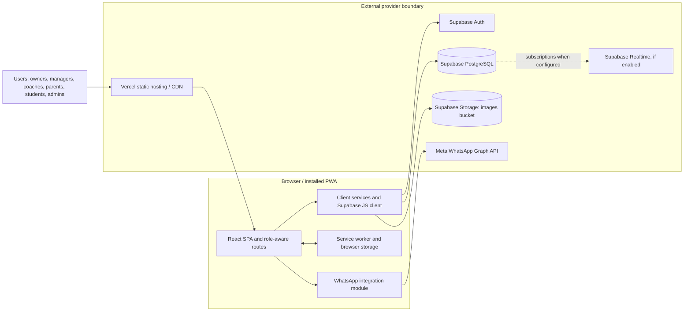

# Application Overview & Security Assessment Brief

**Application:** Karate Club Management System (also referred to as Club Management System)  
**Maintained by:** Kounga Solutions (per task context)  
**Review type:** Repository-based technical discovery; not a penetration test, vulnerability assessment, audit or compliance opinion  
**Evidence date:** 17 October 2026

## Scope and evidence conventions

This brief is based on application source, package metadata, deployment configuration, SQL/schema documentation, user documentation and automated tests present in this repository. It does not connect to hosted services or inspect live infrastructure. Repository documentation describes intended architecture in places; where code does not confirm a claim, the distinction is stated. Database backup artifacts exist in the repository and were not inspected for record contents.

“Confirmed in source” means code/configuration implements the described mechanism; it does not establish that the deployed service is configured correctly or that the control is effective. “Configuration-dependent” means operation depends on provider settings or deployment values unavailable here. “Not identifiable” means this repository does not provide enough evidence to establish the control.

## 1. Executive Application Overview

### Purpose and users

The Karate Club Management System is a browser-based business application for martial arts schools and organizations. It brings administrative tasks—such as maintaining student and family records, organizing classes and centers, recording attendance and grading progress, managing payments, and communicating with families—into one application. Its multi-organization model is intended to support separate clubs, each with locations and role-specific users.

The UI and route set indicate these user groups: platform super administrators, organization owners, center managers, coaches, parents and students. Organizations can manage their own operational workflows, while platform administration pages cover organization setup, users, pricing and subscription/financial information.

### Summary

| Item | Repository-supported description |
|---|---|
| Business purpose | Club operations, student lifecycle, scheduling, attendance, progress, billing and communications |
| Application form | React single-page web application with responsive/PWA features |
| Maturity | Substantial feature surface, user guides, schema documentation and service/component tests are present. Release cadence, production usage, service-level objectives and support arrangements are not established here. |
| Frontend | React 18, React Router, Tailwind CSS, React Context, Supabase JavaScript client |
| Backend/data | Supabase client-facing APIs and PostgreSQL data model are used directly by the browser application |
| Hosting approach | Vercel static build and SPA fallback routing are configured in `vercel.json`; actual active deployment is not verified |
| Major external services | Supabase (Auth, database, Storage, Realtime where enabled); Meta WhatsApp Graph API integration |
| Other capabilities | CSV/PDF export, image handling, PWA/offline shell, browser notifications and push subscription code |

`package.json` identifies the application as `karate-club-management`, version `0.1.0`, and uses Create React App (`react-scripts`). `vercel.json` configures a static build from the `build` directory and routes unmatched paths to `index.html`. `DEPLOYMENT.md` describes Vercel and Supabase deployment but is documentation, not proof of a current production environment. It also contains build statements that differ from `package.json`; deployment procedures should be reconciled before being treated as authoritative.

## 2. Application Functionality

| Feature | Business purpose and interaction | Backend/data and external services |
|---|---|---|
| Accounts and organization onboarding | Users sign in, register or reset passwords. Owners and administrators create organizations; registration flows support parent and organization onboarding. | Supabase Auth and `profiles`, `organizations`, invitation/registration-related records through `src/contexts/AuthContext.js` and registration pages. |
| Organization and center operations | Owners/managers maintain locations, classes, coaches, memberships and organization settings. | Supabase tables including organizations, centers, classes, profiles, students, enrollments and assignments. UI pages include `src/pages/Centers.js`, `Classes.js`, `Coaches.js` and `OrganizationSettings.js`. |
| Student, family and parent records | Authorized users maintain student/parent information, enrollment and family relationships. Parents can access student-related views. | Profile and student data in Supabase; the schema docs describe contact details and student/guardian relationships. `src/pages/Students.js`, `Parents.js`, `ParentDashboard.js`. |
| Scheduling and attendance | Staff manage recurring classes, exceptions and special classes; record attendance and view reports. | Classes, sessions, schedule exceptions, attendance and training-hour data. `src/pages/UpcomingClasses.js`, `MarkAttendance.js`, `AttendanceReport.js`; `src/services/AttendanceService.js` and `SpecialClassService.js`. |
| Skills, belt progression and syllabus | Coaches/administrators maintain curriculum and record student progress toward grading. | Belt levels, syllabus content, progress and training-hour records; `src/pages/StudentProgress.js`, `BeltLevels.js`, `Syllabus.js`, `src/services/BeltProgressionService.js`. |
| Fees, bills and financial administration | Organizations manage recurring bills, one-time payments, discounts, currencies and reports. Platform pages manage subscription/pricing-related information. | Billing/payment records and organization-level pricing data are represented in schema docs and pages such as `Payments.js`, `OneTimePayments.js`, `OrganizationBillingPage.js`, `SuperAdminFinancialDashboard.js`. Repository evidence shows payment administration/data, not a verified card processor integration. |
| Internal messages and notifications | Users communicate within the application and manage notification preferences; some workflows send WhatsApp messages to opted-in contacts. | Supabase messages/notification preferences and direct WhatsApp Graph API calls from `src/lib/whatsapp.js`. Message content and recipient details are operational data. |
| Tournaments and special events | Organizations configure events, event options, registrations and parent/student participation. | Tournament/event/registration records in service and page modules including `TournamentService.js`, `TournamentRegistrationService.js`, `TournamentManagement.js`. |
| Marketing, exports and media | Administrators manage public/marketing content; users export reports and upload profile or organization imagery. | Supabase tables and Storage; CSV/PDF generation uses PapaParse and jsPDF. `src/services/ExportService.js`, `DataExportService.js`, `src/lib/imageService.js`. |
| PWA and notifications | The browser can install the app, cache selected shell assets and request notification/push permission. | Service worker in `public/service-worker.js`, registration helpers in `src/serviceWorkerRegistration.js`; push subscription requires deployment-side VAPID configuration. |

These descriptions reflect available routes and modules. Feature availability may be gated by organization settings, role, environment variables or backend policies.

## 3. Technical Architecture

### Components and data flows

The browser application calls Supabase directly using `@supabase/supabase-js`; this repository does not establish a separate application server/API tier. The UI includes route-level access checks and business services that issue Supabase table/storage calls. Supabase Auth provides account sessions. PostgreSQL is the application data store. Optional storage, realtime, and authentication behavior depend on Supabase project configuration. WhatsApp requests use browser `fetch` to Meta’s Graph API.

**Trust boundaries and flows:** (1) user device/browser to Vercel-hosted static assets; (2) browser to Supabase APIs with the public client key and user session; (3) browser to Meta Graph API for WhatsApp messaging and status calls; (4) browser/service worker local storage and caches. The code demonstrates these routes, but TLS enforcement, provider tenant configuration, database policies, retention, and what data reaches provider logs require external verification.

### Technology and deployment evidence

- `src/index.js`, `src/App.js`: React app bootstrapping, contexts, lazy page imports and client-side routes.
- `src/lib/supabase.js`: Supabase client created from `REACT_APP_SUPABASE_URL` and `REACT_APP_SUPABASE_ANON_KEY`; session persistence, token refresh and URL session detection are enabled in the client options.
- `src/lib/whatsapp.js`: calls `https://graph.facebook.com/v22.0` using bearer authorization from a `REACT_APP_` value.
- `src/lib/imageService.js`: compresses images in-browser, uploads to Supabase Storage bucket `images`, and obtains a public URL.
- `vercel.json`: static build, asset cache headers and SPA fallback. It includes environment entries for the public Supabase client settings; actual build output and currently deployed variables are not checked.
- No repository evidence establishes a separate backend service, deployed edge functions, queue/message broker, or AI/ML integration. `SYSTEM_DOCUMENTATION.md` calls edge functions planned; this is not implemented evidence.

## 4. Data Classification and Handling

The application processes data that should be treated as confidential operational information, including information about children and families. This categorization is based on fields/workflows in source and schema documentation, not on an organizational classification policy.

| Data category | Examples evidenced by code/schema | Origin and processing | Storage/transmission and lifecycle evidence |
|---|---|---|---|
| Identity and contact | User names, email, phone/WhatsApp number, role, profile and parent/guardian relationships | Registration, account/profile management, invitations and administrative entry | Supabase Auth/profile records; WhatsApp numbers may be sent to Meta for opted-in messaging. Deletion/retention policy not established. |
| Child/student-related personal data | Student identity, guardian contact, enrollment, attendance and progress | Parent or staff entry; class and progress workflows | Supabase records; exports can produce files locally in browser. No repository-wide retention schedule found. |
| Potentially sensitive personal data | Schema documentation includes a medical conditions reference and student-related health/clearance concepts | Potentially entered or associated with student operational records; precise current usage should be confirmed against live schema and UI | Backend storage is indicated by schema materials; access restrictions, retention and external disclosure are not established. No actual records are reproduced here. |
| Commercial/financial | Bills, fees, discounts, payments, organization subscriptions, invoices and billing history | Entered/calculated in billing workflows and platform administration | Supabase data and downloadable reports. A payment processor/card data flow is not identifiable from reviewed dependencies/code. |
| Communications | Internal message subject/body, notifications, WhatsApp templates, delivery status | Created by users or application workflows | Internal Supabase records; WhatsApp message calls transmit recipient number and message/template content to Meta. Email delivery provider is not identifiable. |
| Operational/security telemetry | Registration attempt fields include IP address, user agent, result/error; timestamps and delivery states | Generated by signup, messaging and application workflows | Some schema docs describe database logs; browser code emits console messages. Central log retention/monitoring is unknown. |
| Images | Profile, organization, center or class images | Uploaded through browser image service and compressed to JPEG | Supabase Storage public URL is generated. Bucket access policy, deletion lifecycle and image metadata handling require runtime verification. |
| Local browser state | Supabase session, auth profile cache, theme and password-reset-mode flags; service-worker caches | Created during app use | Supabase JS persists session; `AuthContext.js` stores a 24-hour auth data cache in `localStorage`; service worker caches same-origin GET responses. Effective cache scope/clearance and browser-device controls are not established. |

The repository contains dated database backup files under `prisma/backups/`, including JSON and archive formats. Their content was not inspected or included in this brief. Backup access, encryption, retention and restoration controls cannot be established from names alone.

Data minimisation is mixed/unknown: image uploads are resized and recompressed in the browser, and WhatsApp message selection checks an opt-in field in some workflows. The code and documentation do not establish a complete collection-purpose inventory, field-level minimisation standard, retention schedule, or reliable account-level deletion workflow.

## 5. Existing Security Architecture and Controls

| Security area | Observed implementation | Evidence / source location | Verification status |
|---|---|---|---|
| Identity and authentication | Supabase Auth client supports sign-in, sign-up, sign-out and password reset. Session persistence, refresh and URL session detection are configured. | `src/lib/supabase.js`; `src/contexts/AuthContext.js`; `src/pages/Login.js`, `ResetPassword.js` | Confirmed in source; provider settings and runtime behavior require verification |
| MFA / SSO | No MFA or enterprise SSO implementation is identifiable in the reviewed application code. Supabase project-level capabilities/settings are outside repository evidence. | `src/lib/supabase.js`; `package.json` | Not identifiable from repository |
| Route access checks | `ProtectedRoute`, `SuperAdminRoute` and route role lists redirect unauthenticated or disallowed UI users. | `src/App.js` | Confirmed in source; client-side checks are not proof of backend authorization |
| Role and tenant scoping | Auth context loads profile/organization; many page queries filter by `organization_id`, and some views add role/center filters. | `src/contexts/AuthContext.js`; e.g. `src/pages/Centers.js`, `Classes.js`, `Parents.js` | Confirmed in source; consistency and backend enforcement require runtime/source-wide assurance |
| Database authorization / RLS | Supabase is used directly from browser and docs describe RLS. Reviewed SQL/schema materials did not provide an auditable, complete policy set sufficient to confirm per-table RLS coverage or correctness. | `SYSTEM_DOCUMENTATION.md`, `DEPLOYMENT.md`, `scripts/full_db.sql`, schema materials | Documentation only / requires runtime verification |
| Privileged administration | Client module can construct an admin Supabase client from `REACT_APP_SUPABASE_SERVICE_ROLE_KEY`, and multiple browser-side workflows reference admin user creation. Any `REACT_APP_` value used in a Create React App build is intended for client inclusion. No value is reproduced here. | `src/lib/supabase.js`; references in `src/contexts/AuthContext.js`, `src/pages/Coaches.js`, `Parents.js`, `ManagerAssignment.js` | Confirmed in source; effective deployment exposure/configuration requires review. This design warrants priority governance review. |
| Data protection in transit | Provider URLs use HTTPS for Supabase and WhatsApp endpoints; Vercel hosts static content in documented setup. | `vercel.json`, `src/lib/whatsapp.js`, `src/lib/supabase.js` | Confirmed endpoint configuration; TLS policy, certificate behavior and production enforcement require runtime verification |
| Encryption at rest / key management | No application-level encryption-at-rest implementation or key management workflow identifiable. Provider-managed encryption/configuration cannot be verified. | Repository scan of application/configuration | Not identifiable from repository; provider-dependent |
| Secrets management | Supabase and WhatsApp settings are referenced through build-time `REACT_APP_` environment variables. Vercel config contains the public Supabase URL and public/anonymous client key. No server-side secret broker/backend boundary is evident. | `src/lib/supabase.js`, `src/lib/whatsapp.js`, `vercel.json` | Confirmed in source; deployment values and secret handling require verification |
| Input validation | Some forms use `react-hook-form` and field-level validation; Supabase/PostgreSQL constraints may also exist but are not fully evidenced. | `package.json`; e.g. `src/pages/Login.js`, operational forms | Confirmed in source for selected forms; coverage and backend validation require verification |
| Output handling | React JSX provides normal framework escaping for text rendering; export generation and user-managed marketing/message content also exist. | React pages, `src/services/ExportService.js`, `MarketingCMS.js` | Confirmed in source for UI framework; contextual handling requires review |
| CORS, headers, throttling, request limits | No application server middleware or comprehensive security-header/rate-limit configuration is identifiable. `vercel.json` contains asset caching headers but no broad security header policy. Provider controls are unknown. | `vercel.json`, package and source | Not identifiable from repository / configuration-dependent |
| Errors and logging | Many services catch errors and log to browser console; auth cache and service worker also log. Some user-facing error states exist. No central error tracker/audit pipeline is evidenced. | `src/contexts/AuthContext.js`, `src/services/*`, `public/service-worker.js` | Confirmed in source for console/error handling; monitoring and log exposure require runtime verification |
| File upload/storage | Images are resized/re-encoded in browser and uploaded as JPEG to Supabase Storage; a public URL is returned. | `src/lib/imageService.js` | Confirmed in source; bucket policy, upload size/type controls and public access require runtime verification |
| PWA caching | Service worker caches static assets and same-origin GET responses, with a network-first branch for paths it identifies as API/Supabase. Background sync function is a placeholder. | `public/service-worker.js`, `src/serviceWorkerRegistration.js` | Confirmed in source; actual cache contents and production behavior require runtime verification |
| Third-party messaging | WhatsApp API calls include a bearer token sourced from a build-time `REACT_APP_` setting and send message data from browser code. | `src/lib/whatsapp.js`, `src/services/NotificationService.js` | Confirmed in source; configuration and provider controls require verification |
| Dependency controls | `package-lock.json` pins the resolved dependency graph; `package.json` includes npm overrides. | `package.json`, `package-lock.json` | Confirmed in source; scanning/update cadence and current exposure not established |
| Security tests / CI scans | Unit/component/service tests are present. No security-specific test suite, CI workflow, dependency scanning or release gate is identifiable in the repository file inventory. | `src/__tests__/**`, `package.json`; no CI configuration identified | Confirmed for functional tests; security assurance automation not identifiable |
| Cloud IAM / network segmentation | No infrastructure-as-code for Supabase/Vercel IAM, private networking, firewalling or environment separation was identified. | Repository configuration inventory | Not identifiable from repository |

The client-side admin credential pattern and WhatsApp bearer-token pattern are significant architectural topics because browser build-time variables are not a server-side secret boundary. This is an observation about code structure, not a determination that a live credential is exposed or that a production incident has occurred. Values have deliberately been omitted.

## 6. Current Security Development Practices

### Supported by repository evidence

- `package-lock.json` records resolved npm dependencies; `package.json` declares ranges and several dependency overrides.
- Functional automated tests exist for components, utilities and services under `src/__tests__/`; test helpers and Supabase mocks are present.
- Application forms use React Hook Form in parts of the codebase; route access checks and organization filters appear in client code.
- User-facing operational guides and system/deployment documentation exist, including role-specific guides and testing instructions.
- Some communication workflows explicitly check WhatsApp opt-in before sending.

### Not established

No repository evidence establishes a formal security requirements process, mandatory peer review, threat modeling, secure coding standard, CI security scans, security release approval, vulnerability intake/remediation SLA, risk acceptance process, incident response exercise, or security audit trail. These practices may exist outside the repository. The presence of a test suite or security-related documentation is not evidence of a formal governance process.

## 7. Security Assurance Coverage and Unknowns

**Implementation evidence exists** for Supabase authentication calls, browser session persistence, role-aware route rendering, organization-scoped query patterns, image upload, WhatsApp integration, exports, local caching and functional tests.

**Needs verification** includes effective authorization at the database/API boundary, policy coverage across tables/storage, privileged key handling in build and deployment pipelines, production CORS/security headers, provider authentication/MFA settings, actual deployment environments, cache behavior, bucket visibility, log collection, and current third-party API configuration.

**Documentation is incomplete or inconsistent** in areas including deployment/build instructions, architecture claims versus implementation, complete data inventory, retention/deletion, backup handling, trust boundaries and security operating procedures.

**Cannot be established from this repository**: live Supabase/Vercel settings, real IAM and network controls, production database contents/policies, provider contracts and assurance, monitoring/alert operations, incident response readiness, human approval processes, and control effectiveness.

Topics for investigation—not findings—include:

- Whether authorization is enforced server-side for every table, storage operation and administrative action.
- How client-build variables are scoped, protected and separated between public configuration and privileged credentials.
- What student/guardian and health-related data is actually collected, who can access it, and how long it is retained.
- Whether browser/service-worker caches may retain authenticated responses or other user data after logout.
- Whether public image URLs and export workflows match the organization’s information-handling expectations.
- How WhatsApp message content, opt-in records, provider logs and delivery status are governed.

No vulnerability list, severity rating or compliance conclusion is provided.

## 8. Potential Practical Assessment Areas

| Assessment topic | Why relevant | Available evidence | Potential learning outcomes |
|---|---|---|---|
| Authentication and role-based access assurance | Multiple user types and platform/organization hierarchy; roles influence access to operational and administrative functions. | `src/App.js`, `src/contexts/AuthContext.js`, role-specific pages | Map authentication versus authorization; distinguish UI navigation from enforceable access control; build an evidence-based access matrix. |
| Tenant isolation and database authorization | Direct browser-to-Supabase access and organization-scoped records make data boundary assurance central. | Query filters in pages; Supabase client; schema and SQL documentation | Trace representative data flows; identify backend policy evidence needed; document tenant isolation assumptions without testing production. |
| Privileged credential and secret governance | Client code references admin/service and WhatsApp credentials as build-time environment values. | `src/lib/supabase.js`, `src/lib/whatsapp.js`, account-creation call sites | Classify public versus privileged configuration; map build-time secret exposure pathways; define governance questions for deployment owners. |
| Privacy and data lifecycle assessment | The system handles family/student data, attendance, progress, communications and potentially health-related information. | Schema documentation, profiles/student workflows, export services | Create a data inventory and flow map; assess purpose, minimisation, retention and deletion evidence; identify child-data governance questions. |
| Third-party provider and data transfer review | Supabase stores/processes application data and Meta receives WhatsApp message traffic. | Supabase client, Storage, WhatsApp Graph API integration | Map subprocessors and transfers; identify contract, residency, retention and incident-notification evidence required from service owners. |
| Secure SDLC and supply-chain governance | A sizeable npm dependency set and functional tests exist, while automated security release evidence is not visible. | `package.json`, `package-lock.json`, tests and repository workflow inventory | Separate dependency pinning from vulnerability management; propose evidence for review, scanning and release gates; avoid claiming controls from tools alone. |
| Logging, monitoring and incident readiness | Client console logging and registration/message status data exist, but central monitoring and response evidence are unknown. | `src/contexts/AuthContext.js`, services, schema docs | Identify security-relevant events; distinguish operational records from audit logs; develop questions for alerting, retention and response owners. |
| Storage, export and offline data handling | Public image URLs, browser-generated reports and service-worker caching create distinct data handling paths. | `src/lib/imageService.js`, export services, `public/service-worker.js` | Inventory local and hosted copies; review access/retention expectations; assess privacy and operational implications of offline behavior. |

These topics are learning opportunities based on architecture and available evidence, not declarations of non-compliance.

## 9. Known Limitations of This Review

Source inspection cannot verify live cloud IAM, Supabase RLS and Storage policies, database grants, production security headers, environment-variable values or boundaries, build artifact contents, actual deployment topology, TLS configuration, backups, data residency, monitoring/alerts, runtime behavior, or whether documented setup steps are current. It also cannot verify third-party contractual assurances, human review/approval, staff training, incident response procedures, risk acceptance, or the effectiveness of controls in production. No active security testing or production access was performed.

## 10. Mentor's Quick Reference

| Quick reference item | Summary |
|---|---|
| Purpose | Manage martial arts organizations, centers, students/families, classes, attendance, progression, billing and communications. |
| Stack | React 18 / React Router / Tailwind; Supabase Auth, PostgreSQL and Storage; Vercel static hosting configuration; Meta WhatsApp Graph API integration. |
| Architecture complexity | **Medium.** A single-page client with managed backend is conceptually straightforward, but multi-tenant access, multiple roles, direct database APIs, financial workflows, children’s data, third-party messaging and PWA caching introduce meaningful assurance complexity. |
| Information processed | Identity/contact, child/student and guardian data, attendance/progress, potential health-related data, billing/business data, message content, images and operational records. |
| Main control areas | Authentication and role access; tenant/database policies; privileged credentials; privacy and lifecycle; third-party transfers; storage/cache; logging and supply chain. |
| Best-fit assurance domains | Application security assurance, privacy/data governance, cloud/service configuration governance and secure SDLC evidence. |
| Beginner-friendly assignments | Build feature/data inventory; map an account-to-record workflow; produce role/access matrix; catalogue external transfers; document retention/deletion evidence gaps. |
| Needs deeper technical guidance | Supabase RLS and Storage policy assurance; client-side privileged key pattern; browser cache behavior; effective tenant isolation; production configuration review. |
| Key evidence gaps | Complete current schema/policies; deployment and environment separation; security headers and monitoring; data retention/deletion; backup governance; formal SDLC and incident response evidence. |

---

**Handling note:** This report intentionally omits credential values, backup contents, personal data and proprietary source excerpts. It is a repository discovery brief and should be supplemented with authorized configuration and operational evidence before making assurance conclusions.
