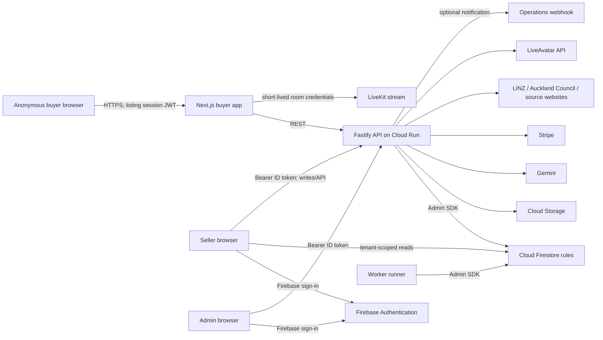

# Kounga Engage — Application Overview & Security Assessment Brief

**Prepared for:** Cybersecurity Governance Team Lead  
**Review type:** Repository based technical discovery (not a penetration test, vulnerability assessment, compliance certification, or complete security audit)  
**Evidence boundary:** Checked-in source, configuration, tests, and documentation. No live cloud account, production data, deployed revision, or provider contract was inspected.

## 1. Executive Application Overview

Kounga Engage is a two-sided SaaS product developed by Kounga Solutions for sellers in real estate and automotive markets. A seller can publish a listing with a branded Digital Agent that buyers reach using a QR code or URL. Buyers can ask questions anonymously, optionally provide contact details, and request human follow-up. Sellers use a portal to manage listings, agents, leads, conversations, imports, and analytics; platform staff use a separate administration application.

The product aims to make listing information available around the clock, capture buyer interest, and give sellers a structured view of leads and engagement. Its maturity is best described as an actively developed MVP/pilot candidate: source documentation tracks pilot-readiness work, but repository inspection cannot establish production operation or customer adoption. Current docs characterize text chat as the potential supervised pilot path and voice/avatar as experimental pending runtime checks (`docs/22-pilot-readiness-and-future-work.md`).

| Item | Repository evidence |
|---|---|
| Application name | Kounga Engage (`README.md`, root package name `kounga-engage`) |
| Users | Anonymous prospective buyers; seller organisation members; platform administrators |
| Stack | TypeScript monorepo, pnpm/Turborepo, Next.js 15 / React 19 front ends, Fastify 5 API, Firebase Authentication, Firestore and Cloud Storage, Google Cloud Run/Cloud Build; Gemini integration; optional LiveAvatar and Stripe |
| Persistence | Cloud Firestore for application records; Cloud Storage for assets/documents. Emulator configuration is present in `firebase.json`. |
| Hosting | Dockerfiles and Cloud Build configs exist for API, buyer, seller, admin, and worker. README describes independent Cloud Run deployment; actual deployed services, regions, identities, and settings are unknown. README's sample commands use `us-central1`; architecture documents note an earlier Sydney proposal. |
| Dependencies/integrations | Firebase Admin/client SDKs; Google Gemini; LiveAvatar with LiveKit browser streaming; Stripe; LINZ and Auckland Council property data providers; optional operations notification webhook; external websites for listing imports. |

The product routes anonymous buyer traffic through a server API, while seller clients perform Firestore reads subject to rules and send writes through the API. The platform administrator has a separate cross-tenant boundary. Several security controls are present in code, but their production effectiveness depends on deployment configuration and runtime verification.

## 2. Application Functionality

| Feature | Business purpose and user interaction | Backend processing and data | External services |
|---|---|---|---|
| Buyer listing directory and QR chat | Buyer browses opt-in active listings or scans a listing QR/URL; opens a chat and can choose a language. | `/api/buyer/listings` returns listings with `showInPublicDirectory`; `/api/buyer/session/init` resolves the listing and issues a listing-scoped session. Chat messages, conversation state, and typed events are stored through the API. | Firestore; Gemini where configured. |
| AI Digital Agent | Answer listing questions using seller-confirmed facts, provide suggested questions, and escalate uncertain questions. | `packages/ai/src/agent.ts` builds grounding, calls provider, validates structured output, and applies `claimGuard`; `packages/domain/src/projection.ts` provides buyer-safe listing projection. | Gemini; offline `FakeProvider` if no Gemini key. |
| Lead capture and contact requests | Buyer may share name/email/mobile and relevant buying context, consent to contact, or request a callback/viewing/test drive. | API validates input with Zod and records leads/contact requests; seller portal lists and updates statuses. | Optional ops webhook for selected alerts; no email send implementation identified in these flows. |
| Seller portal | Seller signs in, manages organisation profile, agents, listings, channel/QR assets, conversations, leads, and analytics. | Firebase ID token is verified server-side; membership yields tenant scope. Seller Firestore reads are rules-controlled; portal writes and sensitive actions use Fastify routes. | Firebase Auth, Firestore, Cloud Storage signed links. |
| Listing onboarding/import | Seller creates listings or imports WordPress exports, spreadsheets, URLs, or website inventory. | API parses uploaded data, extracts listing attributes (optionally AI-assisted), scopes records to tenant, and writes listings. Some imports have quota/rate controls. | Gemini, source listing websites; LINZ/Auckland Council enrichment where configured. |
| Voice/avatar | Buyer may start an optional real-time avatar call from chat. | API creates provider session, returns short-lived stream credentials, tracks and ends sessions; LiveKit client connects from browser. | LiveAvatar, LiveKit, Gemini Live. Availability is configuration-dependent; docs flag first-greeting behavior as unresolved. |
| Subscription and platform administration | Seller views plan/usage and checks out; platform staff manage organisations, plans, add-ons, inquiries, and telemetry. | Stripe webhook verifies signature and syncs billing; admin API verifies Firebase token and active platform-admin record. | Stripe; optional ops webhook. |

## 3. Technical Architecture

### Components and data flow

The high-level trust boundaries are: public buyer browser to buyer/API; seller and admin browsers authenticated by Firebase; seller client to Firestore rules; API/workers using privileged Firebase Admin SDK; and API-to-third-party provider connections. The browser receives short-lived LiveKit credentials for the voice stream. The diagram describes code paths and deployment documentation, not verified deployed topology or network policy.

### Implementation notes

- **Front ends:** Next.js applications in `apps/buyer`, `apps/seller`, and `apps/admin`; React components and client Firebase Auth in seller/admin. The buyer application also contains the marketing site and public listing directory.
- **API:** Fastify in `services/api/src/server.ts`, with buyer, portal, avatar, and admin route modules. Zod schemas validate many route bodies; Firebase Admin SDK performs Firestore access.
- **Data/storage:** Firestore collection model in `packages/data-access/src/collections.ts`; Firestore indexes and rules under `infra/`; Cloud Storage rule file denies direct browser access. API handles asset access/signing.
- **Identity:** Firebase Authentication ID tokens for seller and admin. Anonymous buyers receive HS256 JWTs from the API with issuer, audience, expiry, tenant/listing/agent scope (`services/api/src/token.ts`). Tokens are signed, not encrypted. App Check header presence is recorded but its token is not verified in buyer routes.
- **Background processing:** `services/workers/src/runner.ts` is a polling/dev runner for intent recomputation and escalation notification; worker Docker/Cloud Build definitions exist. A managed scheduler/queue deployment is not established from the repository.
- **AI:** Gemini provider is server-side in `packages/ai/src/provider.ts`; no vector database is used. Voice uses LiveAvatar and LiveKit; client joins stream directly using session credentials.
- **Deployment:** Dockerfiles and Cloud Build build definitions are present. CI promotion, staging separation, deployed IAM, environment settings, and live region require verification.

## 4. Data Classification and Handling

| Data category | Examples and origin | Storage/processing and transmission | Retention/deletion evidence |
|---|---|---|---|
| Public/business listing data | Seller-entered property/vehicle details, approved media, branding, listing URLs | Firestore; buyer-safe projection sent to buyer; some listing text can be sent to Gemini for import or question answering. Selected property data may be enriched via LINZ/Auckland Council. | Seller can delete listing through API. Comprehensive retention policy is not identifiable. |
| Identity/profile data | Seller/admin Firebase UID, email, organisation and membership; agent settings | Firebase Auth plus Firestore user/org/membership records; ID token sent to API. | Account and membership lifecycle/deletion policy not established. |
| Personal information | Buyer name, email, mobile, consent, timeframe/budget/finance/trade-in, inquiry details | Firestore lead/contact/conversation records; visible to tenant members via API/rules; selected operations notifications may include inquiry details. | No general buyer data subject deletion or retention mechanism identified in reviewed paths. |
| Conversation content | Buyer prompts and AI responses; possible buyer-provided personal details | Firestore conversation/messages; message content is submitted to Gemini for AI responses and may be used in summaries. Operational telemetry explicitly excludes raw prompts/replies/contact fields. | Conversation deletion/retention schedule not identifiable. |
| Financial/business billing data | Stripe customer/subscription references, plan and usage records; no card details handled in application source | Stripe processes payment data; application stores billing state/references in Firestore. | Billing record retention/deletion policy not established. |
| Files and media | Listing photos/documents, avatar/logo, WordPress/spreadsheet uploads | Cloud Storage and import request processing; signed links are used for buyer-visible documents. Upload size limits are configured for multipart requests. | Explicit storage lifecycle/deletion rules are not evident. |
| Logs and telemetry | Request IDs, route/status/timing/error categories; Cloud Run logs; safe operational events | Fastify logger and Firestore `operationalEvents`; telemetry code allowlists fields and avoids message body, PII, IP and stack traces. | TTL is described as a required external configuration step; actual TTL and log retention are unknown. |
| Voice session content | Spoken buyer questions and AI response in real-time session | LiveAvatar/Gemini Live and LiveKit data path; provider retention and processing terms are outside repository evidence. | Provider retention and session recording settings unknown. |

Data minimisation evidence includes anonymous-first buyer access, optional rather than mandatory lead capture, buyer-safe listing projection, short-lived listing-scoped token, telemetry field allowlisting, and opt-in public directory listing. The application can nevertheless process personal details in chat text, so the distinction between optional structured capture and arbitrary conversation content matters. Privacy notice, consent wording, retention periods, deletion workflows, data residency, and processor contracts need operational/legal evidence beyond this repository.

## 5. Existing Security Architecture and Controls

| Security area | Observed implementation | Evidence / source location | Verification status |
|---|---|---|---|
| Seller authentication | Firebase ID token verification via Firebase Admin SDK; active membership required for portal routes. | `services/api/src/auth.ts`; `apps/seller/lib/firebase.ts` | Confirmed in source; provider/project configuration requires runtime verification. |
| Admin authentication | Firebase ID token plus active platform-admin record; separate from tenant membership. | `services/api/src/adminAuth.ts`; `services/api/src/routes/admin.ts` | Confirmed in source; admin enrollment and operational governance require verification. |
| Buyer session | API issues signed JWT with 30-minute default TTL, issuer/audience and listing/tenant/agent claims. | `services/api/src/token.ts`; `services/api/src/config.ts` | Confirmed in source; production signing key fails closed if absent, but secret storage/rotation is configuration-dependent. |
| MFA / SSO | Client uses Firebase Auth; repository does not establish MFA enforcement, SSO federation, password policy, or account recovery safeguards. | `apps/seller/lib/firebase.ts`, `apps/admin/lib/firebase.ts` | Not identifiable from repository. |
| Tenant access | Tenant scope derived from verified membership; portal queries filter by tenant; owned-resource helper used for many operations; 404 behavior is documented and implemented in route helpers. | `services/api/src/auth.ts`, `services/api/src/routes/portal.ts` | Confirmed in source; needs runtime/API assurance. |
| Firestore access | Deny-by-default rules; seller reads restricted to active membership; writes denied to clients; buyer/internal collections denied. | `infra/firestore.rules` | Confirmed in source; deployed rules and emulator test results require verification. |
| Storage access | Client read/write denied by rules; API/Admin SDK handles storage and signed URL paths. | `infra/storage.rules`; buyer signed URL route in `services/api/src/routes/buyer.ts` | Confirmed in source; bucket IAM, signed URL duration and deployed rules require verification. |
| Validation and request size | Zod validation used for route inputs; Fastify multipart file size capped at 20 MB. | `services/api/src/server.ts`; route modules | Confirmed in source for observed routes; coverage is not universal proof. |
| CORS | Configured origin list with explicit default origins; `*` can be enabled by environment. | `services/api/src/config.ts`, `services/api/src/server.ts` | Configuration-dependent; production value and browser behavior require verification. |
| Rate limits | Firestore-backed transaction limiter for selected unauthenticated high-value routes; in-memory limiter for many buyer/API routes. | `services/api/src/ratelimit*.ts`; buyer and portal routes | Confirmed in source; in-memory limits are per instance and quotas may race; distributed deployment behavior needs verification. |
| Error handling | Structured API errors, validation failures as 400, generic internal response with request ID; API request telemetry records safe categories. | `services/api/src/server.ts`; `services/api/src/operationalTelemetry.ts` | Confirmed in source; actual logger destinations, access, retention and alerting require runtime verification. |
| AI grounding | Buyer-safe projection, structured model output, claim guard and fallback escalation; no vector DB. | `packages/ai/src/agent.ts`, `claim-guard.ts`; `packages/domain/src/projection.ts` | Confirmed in source; model behavior and privacy/provider settings require runtime verification. |
| Stripe webhook | Raw JSON bytes retained for signature verification; invalid/missing signature rejected. | `services/api/src/server.ts`; `services/api/src/routes/admin.ts` | Confirmed in source; webhook secret and endpoint configuration require runtime verification. |
| Secrets | Environment variables used; deployed buyer token signing key required. Firebase Admin supports ADC or service account configuration. | `services/api/src/config.ts`; `packages/data-access/src/admin.ts` | Configuration-dependent; Secret Manager binding, access policies, rotation and actual secret locations unknown. |
| TLS/network | Cloud Run/custom-domain deployment is described; HTTPS not configured in app source. | `README.md`; Cloud Build/Dockerfiles | Documentation only; live TLS, ingress, network controls and service-to-service access require verification. |
| IAM/service identity | Admin SDK uses ADC in cloud; no service account IAM declarations found in repository. | `packages/data-access/src/admin.ts` | Not identifiable from repository; live IAM must be reviewed. |
| Audit trail | Some seller/admin mutations call `repo.audit`; typed buyer events and operational events also exist. | `services/api/src/repo.ts`; route modules; `services/api/src/operationalTelemetry.ts` | Confirmed in source; coverage, immutability, retention and monitoring unknown. |
| Monitoring/alerts | Health/readiness routes, safe operational telemetry, optional webhook notifications for selected events. | `services/api/src/server.ts`; `operationalTelemetry.ts`; `notify.ts` | Confirmed in source; Cloud Monitoring alerts, on-call response and telemetry retention require verification. |
| Dependency/security scanning | pnpm lockfile and package manifests pin dependency graph; repository review docs note no CI workflow directory. | `pnpm-lock.yaml`, package manifests, `docs/22-pilot-readiness-and-future-work.md` | Confirmed lockfile; automated vulnerability scanning/update policy not identifiable. |
| Security tests | Firestore rules tests and selected AI/avatar/domain unit tests exist. | `tests/rules/firestore.rules.test.ts`, `scripts/test-rules.sh`, `*.test.ts` | Confirmed in source; tests were not run for this brief and do not prove production effectiveness. |
| CI/CD | Cloud Build files build Docker images; deployment instructions are manual. | `services/*/cloudbuild.yaml`, `apps/*/cloudbuild.yaml`, README | Confirmed build config; approval gates, provenance, image scanning and promotion controls not identifiable. |

## 6. Current Security Development Practices

**Supported by repository evidence:** TypeScript types and Zod schemas are used for domain and API data; source includes targeted tests for rules, AI claim guarding, parsing, and avatar services. `scripts/test-rules.sh` runs Firestore rules tests against an emulator. A lockfile is checked in. Cloud Build definitions provide image build steps. Architecture/security documentation records tenant isolation, buyer-safe projection, AI grounding, privacy topics, release/environment considerations, and incident/recovery procedures.

**Not established:** mandatory peer review, security sign-off, PR checks, vulnerability scanning, software bill of materials, signed/provenanced images, release approval, formal threat modelling cadence, vulnerability intake/remediation SLA, risk acceptance, incident exercises, and governance ownership. Documentation includes design decisions and a pilot-readiness checklist, but a documented requirement is not proof of an operating process. `docs/22-pilot-readiness-and-future-work.md` specifically identifies the absence of a checked-in GitHub workflow directory and lists several operational checks still requiring completion.

## 7. Security Assurance Coverage and Unknowns

**Implementation evidence exists** for server-side buyer access, signed buyer tokens, Firebase token verification, tenant-scoped API reads/writes, Firestore deny-by-default rules, client-denied Storage rules, request validation, selected throttling, AI grounding/guarding, safe telemetry, signed webhook verification, and rules tests.

**Requires verification** for deployed Firestore/Storage rules, production signing key and secret binding, CORS origins, Cloud Run ingress/TLS/service identity, Firestore/Storage IAM and region, provider configuration, actual logging/alerting, quotas, retention/TTL, backups/restore, and current deployment revision parity.

**Insufficient or unavailable evidence** includes MFA policy, formal role lifecycle, privacy notices and consent approval, deletion/retention implementation, third-party contractual assurances and residency, CI/CD approvals and scans, code review evidence, incident response execution, and completeness/immutability of audit records. These are investigation topics, not conclusions of non-compliance or vulnerabilities.

## 8. Potential Practical Assessment Areas

| Assessment topic | Why it is relevant | Available evidence | Potential learning outcomes |
|---|---|---|---|
| Authentication and access-control assurance | Three user paths have distinct trust boundaries and Firebase identity. | `auth.ts`, `adminAuth.ts`, `token.ts`, Firestore rules and tests. | Map principal types, token lifecycle, membership and admin authorization; define runtime evidence needed. |
| API and tenant-isolation assurance | Shared Firestore contains multiple organisations; buyer traffic is anonymous and API-mediated. | Portal/buyer routes, ownership helpers, tenant rules. | Trace data flows and authorization decisions; build a control-to-evidence matrix. |
| Privacy and data lifecycle assessment | Leads, conversation text, contact data, billing references, and telemetry have different purposes/providers. | Domain models, routes, privacy page, docs 08/22. | Create data inventory, purpose/retention map, deletion and processor evidence requests. |
| Third-party provider review | Gemini, LiveAvatar/LiveKit, Stripe, and property sources receive or process data. | Provider adapters and integration code. | Identify data transfers, minimisation, account controls, residency and contractual assurance questions. |
| Cloud security governance | Cloud Run, Firebase Admin SDK, Firestore, Storage, secrets and deployment region are central dependencies. | Docker/Cloud Build configs, Firebase rules/config, architecture docs. | Prepare live evidence checklist for IAM, ingress, secret management, environment separation, backup and region. |
| Secure SDLC maturity review | Build definitions and tests exist; automated promotion/scanning evidence is limited. | Manifests, lockfile, tests, Cloud Build YAML, docs 22. | Assess review gates, dependency scanning, release approvals, artifact provenance and remediation workflow. |
| Security logging and incident readiness | Operational telemetry excludes content but relies on external retention/alerting and operational response. | `operationalTelemetry.ts`, health routes, docs 21/22. | Review logging design, retention, alert coverage, runbooks, and incident exercise evidence. |
| AI security governance | Model answers depend on seller content and buyer prompts; outputs are guarded and personal text may be transmitted. | `packages/ai`, grounding docs, buyer routes. | Map AI data flow, prompt trust levels, human escalation, provider governance, testing and disclosure controls. |

## 9. Known Limitations of This Review

Repository inspection cannot establish the live GCP/Firebase project configuration, deployed code revision, IAM grants, service account scope, Cloud Run ingress or scaling settings, HTTPS/domain state, active secrets and rotation, production rules, bucket configuration, backups, monitoring alerts, or actual environment separation. It cannot validate provider contracts, data residency/retention, legal/privacy approvals, operational incident response, human review/approval, code review practices, or security-control effectiveness under real traffic. The review did not execute security testing, inspect production data, contact third parties, or run the repository test suites.

## 10. Mentor's Quick Reference

| Summary item | Reference |
|---|---|
| Purpose | AI-supported listing engagement, lead capture, and seller analytics for property and automotive sellers. |
| Technology | Next.js/React, TypeScript, Fastify, Firebase Auth/Firestore/Storage, Gemini; optional Stripe, LiveAvatar/LiveKit, LINZ/Auckland Council. |
| Architecture complexity | **Medium** — several front ends and API/worker components, shared multi-tenant datastore, anonymous JWT sessions, AI and payment/provider integrations; deployment is managed-service oriented. |
| Information processed | Listing/business data, seller/admin identity, buyer contact and conversation data, billing references, files/media, and operational telemetry. |
| Main control areas | Firebase identity; tenant scoping; deny-by-default Firestore/Storage rules; short-lived buyer JWT; request validation/throttling; AI grounding; webhook signature checks; safe operational telemetry. |
| Best assurance domains | Access control and tenant isolation; privacy/data lifecycle; third-party assurance; cloud/IAM governance; secure SDLC; AI governance and operational logging. |
| Beginner-friendly assignments | Build a data-flow and classification inventory; map tenant authorization evidence; review rules test coverage; create provider data-transfer register; map telemetry/retention questions. |
| Needs deeper guidance | Live GCP IAM and region review; token/authorization assurance; AI threat modelling; privacy/legal interpretation; production monitoring, backup and incident exercises. |
| Evidence gaps | Live configuration and deployment parity; retention/deletion and TTL settings; MFA/role lifecycle; provider contracts; CI/CD scan and approval controls; operational process evidence. |

---

**Handling note:** This document intentionally excludes secret values, credentials, customer records, and proprietary source excerpts. Security-sensitive configuration is described only by category and repository location.
