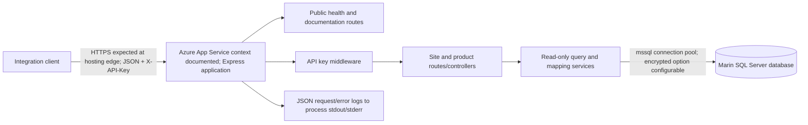

# Marin Integration API — Application Overview & Security Assessment Brief

**Prepared for:** Cybersecurity governance and mentoring review  
**Application owner/developer:** Kounga Solutions  
**Review type:** Repository-based technical discovery; not a penetration test, vulnerability assessment, audit or compliance opinion  
**Evidence reviewed:** Application source, configuration, package manifest and lockfile, tests, scripts, README, client guide and OpenAPI definition present in this repository. No production system or database was accessed.

## 1. Executive Application Overview

The Marin Integration API is a small, read-only service for approved integration clients. It exposes selected site, product catalogue and site-stock information from a Marin SQL Server database over JSON REST endpoints. The likely business users are external or internal systems integrating with Marin inventory; no interactive end-user application is present. The service reduces the need for clients to query the inventory database directly and provides a defined interface with stable response shapes.

| Attribute | Evidence-based description |
|---|---|
| Application name | Marin Integration API (`package.json`, `src/docs/swagger.ts`) |
| Business purpose | Provide approved Marin site, product and site-product information to integration consumers (`README.md`, `src/docs/userGuide.ts`) |
| Main users | Server-to-server integration consumers authenticated with a shared API key; operators managing deployment/configuration. Individual human accounts are not implemented in this repository. |
| Maturity | Functional service with documented endpoints, tests, build/lint/typecheck scripts and deployment notes. Repository alone cannot establish production maturity, service-level support, release cadence or operational history. |
| Stack | Node.js (declared `>=22 <25`), TypeScript, Express 5, `mssql`, SQL Server, Zod, Helmet, Swagger UI/OpenAPI; Jest and Supertest (`package.json`) |
| Hosting | README and OpenAPI name Azure App Service as the production hosting context and show a production endpoint. No deployable Azure infrastructure or pipeline definition is in the repository, so current hosting settings are not independently verified. |
| External dependencies | SQL Server / Marin Inventory database; npm packages from the JavaScript ecosystem. No other runtime API provider is evident. |

**In plain terms:** a client sends an API key to request approved inventory information. The service validates the key, reads selected records from SQL Server, shapes the result as JSON and returns it. It has no write endpoint in the implemented API routes.

## 2. Application Functionality

| Feature | Business purpose and interaction | Backend processing and data | External services |
|---|---|---|---|
| Health check | `GET /health` provides a lightweight availability response; public. | Returns a fixed service/status object without checking database readiness (`src/app.ts`). | None. |
| Site listing | `GET /api/v1/sites`; caller may set `includeAll=true` to include discontinued sites. Requires `X-API-Key`. | Validates the query value and reads `dbo.Customers` for `AccountType = 2`; defaults to non-discontinued records. Returns site ID/name, address, phone, account type and contract/active flags (`src/controllers/siteController.ts`, `src/services/siteService.ts`). | SQL Server. |
| Product catalogue | `GET /api/v1/products`; API-key protected. | Reads active rows from `dbo.Products`, joins category and subcategory display names, and returns pricing, rates, stock quantities, notes and active state (`src/services/productService.ts`). | SQL Server. |
| Products at a site | `GET /api/v1/sites/{siteId}/products`; API-key protected. | Verifies the site exists as account type 2, calculates positive net quantity from hire-out less hire-return details, joins product/category information and returns the result (`src/services/productService.ts`). | SQL Server. |
| Client documentation | Public user guide and Swagger/OpenAPI routes. | Serves embedded HTML and OpenAPI definitions (`src/app.ts`, `src/docs/userGuide.ts`, `src/docs/swagger.ts`). | None. |

The API is read-only from the application's perspective. No create/update/delete routes are registered. The service queries do not perform writes. The site stock endpoint reports a calculation from movement records; it does not change inventory.

## 3. Technical Architecture

### Components and flows

The distinction “HTTPS expected at hosting edge” reflects the published HTTPS base URL, not an in-repository TLS listener configuration. The server creates a Node HTTP server (`src/server.ts`); termination and forwarding at the hosting edge are outside this source.

### Architecture notes

- **Frontend:** No browser-based business frontend. The user guide and Swagger UI are documentation interfaces served by Express.
- **Backend:** Express 5 application, route/controller/service layers, TypeScript models and shared error types (`src/app.ts`, `src/routes/`, `src/controllers/`, `src/services/`, `src/models/`, `src/utils/errors.ts`).
- **Database/storage:** SQL Server accessed using `mssql`; a reusable pool has maximum 10 connections, 15-second connection timeout and 30-second request timeout (`src/config/database.ts`). No application-owned file/object storage is identified.
- **Cloud:** Azure App Service is named in documentation/OpenAPI, but no cloud resource definitions, IAM policy, network rules or environment deployment manifests are present in the reviewed file list.
- **Identity:** No OAuth, SSO or user identity provider. API consumers use one configured shared API key (`src/middleware/apiKeyAuth.ts`).
- **Integrations:** Marin Inventory SQL Server is the main data integration. No outbound HTTP API client is apparent in runtime source.
- **Background work/messaging/AI:** Not identifiable; no such runtime features are implemented in reviewed source.
- **Trust boundaries:** Client-to-API, API-to-SQL Server, and application-to-hosting/log collection boundaries. Network enforcement and database-side permissions need environment-side verification.

## 4. Data Classification and Handling

| Data category | Examples exposed/processed | Origin and processing | Storage, transfer and retention evidence |
|---|---|---|---|
| Business/contact information | Site names, addresses, phone numbers, account type and contract status | Marin `dbo.Customers`; selected and mapped by `siteService` | Persisted in the source database. Returned to authenticated clients over the API. API response persistence, client copies, database retention and deletion policy are not described. Site contact data may identify people depending on source values; no actual records are reproduced here. |
| Commercial information | Product names, pricing/rates, stock/reorder quantities, notes, site-level quantities | `dbo.Products`, categories/subcategories, hire-out and hire-return records | Read from SQL Server and returned to clients. Treat as commercially sensitive pending owner classification. Retention/deletion policy is not in repository. |
| Authentication secret | Shared API key | Environment configuration; compared by auth middleware | `.env` is ignored and `.env.example` contains placeholders only. Deployment secret storage/rotation/access are not established. Secret values are intentionally omitted. |
| Operational telemetry | Request method/path/status/duration; server start/shutdown and errors | Request logger and server/error middleware | Written to stdout/stderr as JSON; downstream collection, retention, access and alerting are not in repository. Request path is logged, so path parameters may form part of logs. Header values are not logged by this middleware. |
| User identity/profile, payment data, AI prompts | None evident | No corresponding application feature or data model identified | Not identifiable as processed by this application from the repository. This does not establish what the underlying database may contain outside queried columns. |

The service limits returned data to fields selected by SQL queries and does not expose a generic SQL interface. Parameterized SQL inputs are used for site ID and `includeAll`. This is evidence of response/query scoping, not a complete privacy or data-minimisation assessment. No application-level retention, export or deletion feature is present; source-of-truth retention belongs to systems outside the API code.

## 5. Existing Security Architecture and Controls

| Security area | Observed implementation | Evidence / source location | Verification status |
|---|---|---|---|
| Authentication | Shared API key required for `/api/v1/*`; missing/incorrect key produces unauthorized response. Health and documentation are public. | `src/app.ts`, `src/middleware/apiKeyAuth.ts`, `src/config/config.ts` | Confirmed in source; key issuance, entropy, rotation and production storage require runtime/operational verification. |
| Key comparison | Uses `timingSafeEqual` when provided and expected byte lengths match; length mismatch returns false before comparison. | `src/middleware/apiKeyAuth.ts` | Confirmed in source; no broader identity or per-client key model is evident. |
| Authorization | All protected routes share the same middleware/key. Site product lookup validates that the site exists and has `AccountType = 2`; no roles, per-client scopes, tenant boundary or resource-ownership mapping is shown. | `src/app.ts`, `src/services/productService.ts` | Confirmed in source for these behaviors; intended client data boundaries require business/runtime verification. |
| Input/query handling | `includeAll` accepts only literal `true`/`false`; blank site ID rejected. SQL query values are bound as parameters. | `src/controllers/siteController.ts`, `src/controllers/productController.ts`, `src/services/siteService.ts`, `src/services/productService.ts` | Confirmed in source. Other infrastructure-level request limits require runtime verification. |
| Transport/data protection | SQL encryption defaults to true and certificate trust defaults false; both are environment-configurable. HTTPS production URL appears in docs. | `src/config/config.ts`, `src/config/database.ts`, `src/docs/swagger.ts` | Configuration-dependent; database TLS negotiation and public HTTPS edge configuration require runtime verification. |
| Secrets | Required values loaded from environment and validated; `.env`/`.env.*` ignored except `.env.example`. No secret values are included in this brief. | `src/config/config.ts`, `.gitignore`, `.env.example` | Confirmed in source for loading/ignore rules; secret manager, deployment injection, access and rotation are not identifiable. |
| HTTP security headers | Helmet middleware enabled; Express `x-powered-by` disabled. | `src/app.ts` | Confirmed in source; effective headers at deployed edge require runtime verification. |
| CORS/CSRF | No CORS middleware or CSRF mechanism identified. README states CORS/CSRF are not enabled for current server-to-server GET-only API. | `src/app.ts`, `README.md` | Confirmed in source/documentation; deployment-level browser access policy not established. |
| Rate limiting / abuse controls | No application rate limiter, per-client quotas or explicit request timeout middleware identified. | `src/app.ts`, `package.json` | Not identifiable from repository; upstream gateway protections unknown. |
| Request size | Express JSON parser has a 100 KB limit. Routes are GET-only in current implementation. | `src/app.ts` | Confirmed in source; effective behavior should be runtime-verified if other body parsers are added upstream. |
| Error handling | Standard JSON error envelope; unexpected failures mapped to generic 500 response. Stack traces omitted from production log configuration; underlying error message is logged. | `src/middleware/errorHandler.ts`, `src/utils/errors.ts` | Confirmed in source; log access and production environment value require verification. |
| SQL access | Queries select specific fields and use a shared pool; README says DB login should be read-only. Repository config does not enforce database grants or identity type. | `src/config/database.ts`, `src/services/`, `README.md` | Configuration-dependent / documentation only for least privilege; verify actual SQL principal and grants. |
| Logging/monitoring | Structured request, lifecycle and server-error events go to console streams. | `src/middleware/requestLogger.ts`, `src/server.ts`, `src/middleware/errorHandler.ts` | Confirmed in source; log centralization, retention, alert rules and security monitoring require runtime verification. |
| Cloud/IAM/network | Azure App Service is named in docs/OpenAPI; no IaC, identity, network, firewall or database access policy files found. | `README.md`, `src/docs/swagger.ts`; repository file inventory | Documentation only for hosting context; controls not identifiable from repository. |
| Dependency management | `package-lock.json` pins dependency resolution; Node engine range is declared. | `package.json`, `package-lock.json`, `.nvmrc`, `.node-version` | Confirmed in source; automated vulnerability scanning, update cadence and lockfile review process not identifiable. |
| Automated security testing | Jest/Supertest tests cover API key acceptance/rejection, input handling, errors and service query behavior. DB layer is mocked in tests. | `tests/app.test.ts`, `tests/*Service.test.ts`, `tests/setupEnv.ts` | Confirmed in source for test coverage; no dedicated security test suite or live database/infrastructure assurance identified. |
| Build/release pipeline | Build, test, lint and typecheck commands exist; deployment notes describe App Service setup. No CI workflow or release gate found in repository file list. | `package.json`, `README.md` | Local scripts confirmed; CI/CD execution and release approvals not identifiable. |

## 6. Current Security Development Practices

**Evidence in code/repository:** strict TypeScript compiler settings are enabled (`tsconfig.json`); SQL is parameterized for dynamic values; configuration is schema-validated with Zod; API error responses are normalized; response fields are explicitly selected and mapped; tests exercise normal and error behavior; ESLint and Prettier configuration plus build, lint, typecheck and test scripts are present.

**Not established:** formal security requirements, threat modelling, documented code review, branch protections, security scans, dependency remediation SLAs, release approval checks, vulnerability disclosure/handling workflow, incident response runbooks, risk acceptance, or formal privacy/compliance governance. The existence of scripts does not establish that they run in CI or block releases. No completed security assessment is documented in reviewed files.

## 7. Security Assurance Coverage and Unknowns

**Implementation evidence exists** for shared-key authentication, parameterized read queries, basic input validation, Helmet, a JSON body limit, generic client errors, SQL connection encryption options, structured logs, and focused unit/API tests.

**Needs verification outside source** includes production HTTPS/TLS, actual Azure App Service settings, database grants and reachability, secret storage/rotation, upstream rate limiting and network controls, log retention/access/alerting, backup/recovery, environment separation, and deployed dependency/build provenance.

**Documentation or process gaps** include no repository-visible infrastructure definition, CI workflow, security policy, threat model, incident response process, formal data retention statement, or third-party assurance record. “Not identifiable” is an evidence boundary, not a finding that a control is absent in the operating environment.

Topics a future analyst could investigate include whether one shared credential gives suitable client separation, how exposed business data is classified and approved, how logs are governed, how the database principal is constrained, and which controls are enforced at the Azure/network edge. This brief does not determine findings, severity, compliance status or remediation.

## 8. Potential Practical Assessment Areas

| Assessment topic | Why it is relevant | Available evidence | Potential learning outcomes |
|---|---|---|---|
| API authentication and access governance | A shared API key protects all data endpoints and is the sole visible client authentication mechanism. | `apiKeyAuth.ts`, `config.ts`, `app.test.ts`, client guide | Document credential lifecycle, consumer separation, authorization boundaries and evidence needed to verify deployed controls. |
| Data classification and minimisation | Responses include customer contact/address data and commercial prices, rates and stock. | Models and SQL projections in `siteService.ts`, `productService.ts` | Build a data inventory, map purposes/recipients and identify retention/ownership questions without accessing production records. |
| SQL Server least privilege and transport | The service reads multiple inventory tables; encryption settings are configurable and least privilege is a README instruction. | `database.ts`, `config.ts`, service queries, README | Define evidence for database identity, grants, TLS settings and network paths; distinguish code intent from environment proof. |
| Secure SDLC evidence mapping | Local tests and quality scripts exist, but CI/release controls are not visible. | `package.json`, `tests/`, ESLint/TypeScript config | Map development controls to a lightweight SSDLC evidence set and identify what execution evidence is needed. |
| Logging and operational security | Request and error events are emitted, but downstream log controls are unknown. | `requestLogger.ts`, `errorHandler.ts`, `server.ts` | Assess log content, sensitive-data exposure, retention, access, alerting and incident usefulness. |
| Azure deployment governance | Azure App Service is documented without checked-in infrastructure definitions. | README, OpenAPI server list | Create an environment evidence checklist for identity, ingress, TLS, network restrictions, configuration and deployment separation. |
| API input/query assurance | Query values are validated and bound; endpoint tests cover representative invalid input. | Controllers, service queries, `app.test.ts`, service tests | Practice tracing untrusted input to SQL and assess test coverage boundaries using safe code review methods. |
| Dependency and release assurance | A lockfile and toolchain are present; automated scanning and release gates are not evidenced. | `package.json`, `package-lock.json` | Design a dependency inventory and evidence-based review of scanning, update and release processes. |

These are learning opportunities, not conclusions of non-compliance or identified vulnerabilities.

## 9. Known Limitations of This Review

Source inspection cannot verify live Azure IAM, App Service runtime settings, ingress/TLS termination, firewall/network rules, SQL permissions, secret-store configuration, production environment parity, actual log routing or retention, backups, monitoring alerts, uptime, incident response readiness, contractual assurances, human approvals or control effectiveness. It also cannot establish the contents or classification of the full Marin database. Tests use mocked database behavior and do not demonstrate production database or cloud behavior. No production data or endpoint was accessed.

## 10. Mentor’s Quick Reference

| Item | Summary |
|---|---|
| Purpose | Read-only integration API for Marin site and product information. |
| Stack | Node.js/TypeScript, Express 5, SQL Server via `mssql`, Zod, Helmet, Swagger UI; Jest/Supertest. |
| Architecture complexity | **Low** — one API service, one principal database integration, three data endpoints, no frontend business app or asynchronous subsystem evidenced. Deployment and database security still span external cloud/operations boundaries. |
| Information processed | Site identifiers, names, addresses, phones and contract flags; product pricing/rates, notes and stock; site product quantities; operational request/error logs; API key as configuration. |
| Main control areas | Shared API-key authentication, query/input handling, database access/TLS, HTTP headers, secret handling, error/log handling, cloud edge and dependency/release governance. |
| Best-fit assurance domains | API security, information classification/privacy, least privilege, secure SDLC, cloud governance and security monitoring. |
| Beginner-friendly assignments | Trace authentication and endpoint authorization; map data fields and flows; review existing test evidence; create a control-evidence matrix for database and deployment configuration. |
| Needs deeper technical guidance | Azure ingress/IAM and database network controls; credential lifecycle design; SQL Server grants; production observability and incident response. |
| Key evidence gaps | No IaC or CI workflow; no visible deployment/security policies, threat model, retention schedule, scan reports or operational runbooks. |

---

**Repository evidence index:** `src/app.ts`; `src/server.ts`; `src/config/config.ts`; `src/config/database.ts`; `src/middleware/apiKeyAuth.ts`; `src/middleware/requestLogger.ts`; `src/middleware/errorHandler.ts`; `src/controllers/`; `src/services/`; `src/models/`; `src/routes/`; `src/docs/swagger.ts`; `src/docs/userGuide.ts`; `tests/`; `package.json`; `package-lock.json`; `.env.example`; `.gitignore`; `README.md`.
