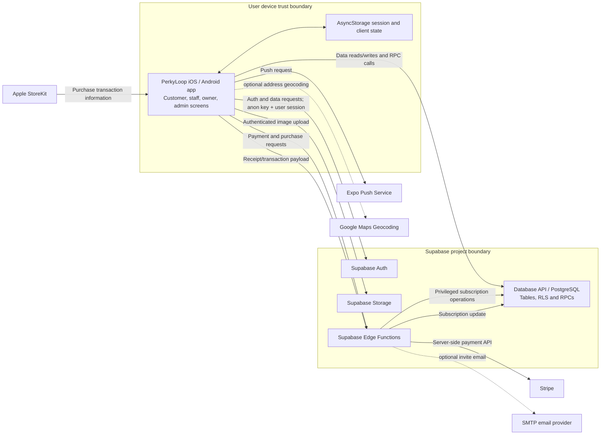

# PerkyLoop Application Overview & Security Assessment Brief

**Prepared for:** Kounga Solutions cybersecurity governance review  
**Review type:** Repository-based technical discovery  
**Review date:** 17 October 2026  
**Scope:** Source, configuration, SQL/schema artifacts, tests, build/deployment guidance and supporting documentation in this repository.

> This brief describes evidence visible in the repository. It is not a penetration test, vulnerability assessment, compliance certification or complete security audit. Source artifacts do not prove that corresponding controls are deployed or effective in a live environment.

## 1. Executive Application Overview

PerkyLoop is a mobile loyalty platform maintained by Kounga Solutions. Independent customers join participating shops' digital loyalty programmes, collect stamps through QR-code interactions and redeem rewards. Shop owners configure their brand, loyalty programme, staff, promotions and subscription; staff perform customer-facing stamp and redemption workflows.

The business problem is replacing paper loyalty cards with an app that supports multiple shops and provides merchants with tools to engage and administer customers. The source includes customer, staff, shop-owner and super-admin screens. The product and technical documentation describe broader capabilities; this brief treats code as primary evidence and identifies uncertain or unverified behaviour explicitly.

The repository appears to represent an actively maintained, release-oriented mobile application: `package.json` reports version 1.0.9, `app.json` version 1.0.10 and native build numbers 13. Build and submission scripts and EAS profiles exist. This indicates release preparation, not independently confirmed store availability or production use.

**Technology at a glance:** React Native 0.81, Expo SDK 54, TypeScript, Expo Router, TanStack Query and Zustand on the client; Supabase Auth, PostgreSQL, Storage and Edge Functions as backend services; Stripe for card billing/subscriptions on Android and Apple StoreKit purchases on iOS. Expo Push is used for push delivery. No AI/ML integration was identified.

The mobile app connects directly to Supabase APIs using the Supabase client and a public/anonymous project key configured in the Expo app. Privileged operations are intended to use Supabase Edge Functions and server-side environment secrets. SQL setup and function source is present, but no Supabase project configuration or deployment pipeline sufficient to establish live deployment state was identified.

| Area | Repository evidence |
|---|---|
| Application name | PerkyLoop (`app.json`) |
| Business purpose | Digital shop loyalty, stamps, rewards, promotion and subscription management (`PRODUCT_DOCUMENTATION.md`; app screens and services) |
| Users | Customers, shop staff, owners and super-admin role in application code |
| Platforms | iOS and Android in `app.json`; a web export setting exists, but web is not among configured app platforms |
| Hosting/deployment | Mobile native builds through Expo/EAS profiles (`eas.json`); Supabase-managed backend is indicated by code and docs. Actual hosting and deployment state are not verified. |
| Major external dependencies | Supabase, Stripe, Apple App Store/StoreKit, Expo Push, Google Maps Geocoding (optional key path), SMTP provider configured through Edge Function environment |

## 2. Application Functionality

| Feature | Business purpose and user interaction | Backend processing and data | External services |
|---|---|---|---|
| Accounts and profiles | Email/password sign-up, sign-in, password reset, profile editing and account deletion flow (`app/(auth)/*`, `app/edit-profile.tsx`) | Supabase Auth plus `users` profile data: email, name, phone, location, sex, birth date, avatar and role (`src/api/auth.ts`, `scripts/DB.sql`) | Supabase Auth and Storage |
| Shop discovery and profile | Browse shops, view branding, contact/location details, active loyalty programmes and locations (`app/(tabs)/explore.tsx`, `app/shop/[id].tsx`) | Reads shops, shop locations, loyalty programmes and related customer membership/reward data via `src/api/shops.ts` | Map/directions/call/email handoff through device links; Google geocoding is optional |
| Loyalty enrollment and QR flow | Customer displays a loyalty QR; staff/owner scans it to issue stamps; customer sees balances and rewards (`app/scan.tsx`, `app/scan-result.tsx`, `app/redeem-reward.tsx`) | Loyalty memberships, rewards and ledger; SQL artifacts include transactional `issue_stamps` and manual adjustment RPCs (`scripts/issue_stamps_rpc.sql`, `scripts/adjust_stamps_rpc.sql`) | Device camera |
| Shop administration | Owners create shops/branches, set branding/contact details, define loyalty programmes, manage menu/gallery images and view activity/analytics (`app/(owner)/*`, `app/shop-settings/*`) | Shops, memberships, programmes, menu images and ledger/analytics data; direct Supabase data API and Storage (`src/api/shops.ts`, `src/api/menu.ts`) | Supabase Storage; optional Google Maps geocoding |
| Staff invitation and access | Owners invite an existing PerkyLoop user; invitee accepts/rejects; owner enables, disables or removes staff (`app/shop-settings/staff.tsx`, `app/accept-invite/[inviteId].tsx`, `src/api/staff.ts`) | `staff_invites`, `shop_memberships`, and in-app `notifications` | A `send-staff-invite` email function exists; its invocation in the main invitation flow was not established. |
| Promotions and notifications | Owners create promotions and can initiate customer push notifications (`app/create-promotion.tsx`) | `promotions`, `user_devices`/`users.push_token`, in-app notifications | Expo Push API and OS notification delivery |
| Subscription and billing | Owners select plans, provide payment details, view/cancel/reactivate subscriptions (`app/shop-settings/subscription.tsx`, `payment-setup.tsx`) | Shop subscription fields and `payment_events`; Stripe Edge Functions for Android/card paths; Apple receipt-verification function for iOS | Stripe and Apple StoreKit/App Store |

The code also has super-admin screens for shops, owners and subscriptions. The details and safeguards for administrative assignment are not established by screen presence alone.

## 3. Technical Architecture

### Components

- **Mobile client:** React Native/Expo, TypeScript, Expo Router file-based screens, React Hook Form and Zod forms, TanStack Query and Zustand state (`package.json`, `app/`, `src/`).
- **Backend/data:** Supabase JS client calls Auth, PostgREST/database tables, RPCs, Storage and Edge Functions (`src/lib/supabase.ts`, `src/api/`, `supabase/functions/`). PostgreSQL schema context is in `scripts/DB.sql`.
- **Payments:** Stripe SDK in Supabase Edge Functions plus native Stripe React Native integration for payment sheet flows; Apple IAP service and a receipt function for iOS (`src/services/`, `supabase/functions/`).
- **Notifications:** Expo Notifications client and direct Expo Push API calls (`src/lib/notifications.ts`).
- **Build/distribution:** EAS build profiles and scripts for local/EAS iOS and Android build/submission. No CI workflow for build or security checks was identified; the only workflow found is a Supabase keep-alive workflow.
- **Background jobs/messaging:** No queue or scheduled application worker identified. Push sending is initiated from application workflows. A Stripe webhook handler exists as library code in `src/api/webhooks.ts`, but its comments describe mounting it in Express; no Express server or webhook deployment definition was found.
- **AI/ML:** None identified.

### High-level flow and trust boundaries

The main trust boundaries are the end-user device, Supabase project, and external payment, push, email and geocoding providers. Database row policies, Edge Function gateway settings and provider-side controls are configuration/runtime matters and cannot be inferred from the client alone. The diagram shows observed integration paths; dashed paths are optional or invocation not fully established.

## 4. Data Classification and Handling

| Data category | Examples present in schema/code | Origin and processing | Storage/transmission and lifecycle evidence |
|---|---|---|---|
| Public/business information | Shop names, descriptions, logos, programme descriptions, promotions, public shop IDs and contact/location details | Entered by owners; displayed to customers; used in shop search | PostgreSQL `shops`, `loyalty_programs`, `promotions`, `shop_locations`; images in Supabase Storage. Public-read policy and bucket settings require verification. |
| Identity and profile data | Email, password (handled by Auth), name, avatar, role, account status | User registration/profile screens and Supabase Auth | Auth user plus linked `public.users`; persistent client session in AsyncStorage. A user profile deletion/soft-delete path exists, but retention and cascade behaviour are not fully established. |
| Personal information | Phone, country, city, postal code, sex, date of birth; shop contact details | Optional profile or business profile fields | Supabase database. Geocoding can transmit business addresses to Google Maps when enabled. No privacy schedule or data retention policy was identified. |
| Loyalty and behavioural data | Customer-shop/program memberships, stamp balances, rewards, redemptions, staff actor IDs, timestamps and adjustment reasons | QR-based customer/staff workflows and owner adjustments | `loyalty_memberships`, `rewards`, `loyalty_ledger`; ledger schema retains action and actor information. No retention controls identified in repository. |
| Commercial and financial metadata | Plan, price, subscription state, Stripe customer/subscription identifiers, payment event amounts/status and metadata | Owner billing workflows, payment providers and Edge Functions | Supabase shop/payment event records and Stripe. Card details are collected through Stripe payment UI; repository does not show storage of card number data. Contractual/provider retention is unknown. |
| Images and files | Avatars, shop branding, promotion and menu/gallery images | Device photo picker, compression and upload code | Supabase Storage buckets named `avatars`, `shop-logos`, `promotions`, `menu-images`; generated public URLs are used. Bucket access, object limits, malware checks and retention are not established. |
| Logs and telemetry | App console messages, Edge Function console output, build logs in repository | Client and server error/operation paths | No integrated error-monitoring SDK was identified. Repository contains build logs; this brief does not reproduce their contents. Production log access/retention is unknown. |
| Push data | Push tokens, notification titles/bodies and structured notification payloads | Device registration and promotion/in-app event flows | Token may be stored in `users.push_token` and `user_devices`; notification content is sent to Expo Push. Provider retention and deletion lifecycle unknown. |
| AI prompts/conversations | None identified | N/A | No AI feature or AI data flow identified. |

Data minimisation is mixed and cannot be assessed as a programme-wide practice. Sign-up fields include optional demographic and location attributes, while profile schemas permit them. Image picking requests square, 70%-quality output, but explicit maximum dimension/file-size enforcement is not evident in the inspected upload helper. Account deletion and soft-delete references exist; comprehensive deletion across auth, database, storage, payment and notification providers requires verification.

## 5. Existing Security Architecture and Controls

| Security area | Observed implementation | Evidence / source location | Verification status |
|---|---|---|---|
| Identity and authentication | Supabase email/password sign-up and sign-in; password reset/update; persistent and refreshed auth session configured with AsyncStorage | `src/api/auth.ts`, `src/lib/supabase.ts`, `app/(auth)/*` | Confirmed in source; provider policy and runtime configuration require verification |
| MFA/SSO | No MFA or SSO flow identified | Auth screens and `src/api/auth.ts` | Not identifiable from repository |
| Session handling | Auto-refresh on app foreground and stop on background; Supabase process lock configured | `src/lib/supabase.ts` | Confirmed in source; runtime behaviour requires verification |
| Authorization and roles | UI routing and role-aware workflows; shop membership records model customer/staff/owner. Several service queries filter user/shop IDs. Database policies are critical because the client makes direct data API calls. | `app/_layout.tsx`, `src/api/staff.ts`, `src/utils/actorRole.ts`, `scripts/DB.sql` | Client-side checks confirmed; backend enforcement configuration-dependent |
| Tenant/resource isolation | Schema associates shop, user and programme IDs; RPC scripts contain shop/program lookups. Complete live RLS policies for all tables are not included. | `scripts/DB.sql`, `scripts/issue_stamps_rpc.sql`, `scripts/adjust_stamps_rpc.sql`, `supabase/fix-user-signup-rls.sql` | Configuration-dependent; requires runtime verification |
| Input validation | Zod schemas for profile, shops, loyalty, promotions, QR and invitations; some client flows call validation. SQL RPCs enforce selected quantity/state constraints. Coverage across all entry points is not established. | `src/types/schemas.ts`, `src/types/validation.ts`, `src/api/loyalty.ts`, SQL RPC scripts | Confirmed in source for listed paths; end-to-end coverage requires review |
| Data transport | Supabase, Stripe, Expo and Google Maps integrations use HTTPS URLs or provider SDKs. No app-level TLS policy/pinning configuration identified. | `app.json`, `src/lib/notifications.ts`, `src/utils/geocoding.ts`, Edge Functions | Configuration-dependent; runtime transport verification required |
| Secrets | Edge Functions retrieve Stripe and service-role keys from `Deno.env`; client embeds Supabase anon key in Expo config. `.env` patterns are gitignored and `.env.example` uses placeholders. | `supabase/functions/*/index.ts`, `app.json`, `.gitignore`, `.env.example` | Server secret use confirmed in source; actual secret storage and rotation unknown. Public client configuration is not a privileged secret. |
| Storage | Client uploads with current Supabase bearer session; public URLs are generated for images. | `src/utils/image-upload.ts`, `src/api/menu.ts` | Client behavior confirmed; bucket privacy/policies and object controls require runtime verification |
| CORS and request limits | Edge Functions set permissive `Access-Control-Allow-Origin: *`; selected headers are listed. No explicit rate limiting or request-size limit identified. | `supabase/functions/*/index.ts` | Confirmed in source for CORS; gateway/rate controls require runtime verification |
| Error handling | Functions catch errors and return JSON; client has an ErrorBoundary. Several paths log raw errors and one Apple verification function returns update error text. | `src/components/ErrorBoundary.tsx`, Edge Function files, `src/config/production.ts` | Confirmed in source; production exposure/log policy requires runtime verification |
| Security headers | No general mobile API response security-header policy identified; Edge Functions define CORS headers only. | `supabase/functions/*/index.ts` | Not identifiable from repository; platform defaults unknown |
| Payments | Stripe secret used server-side by Edge Functions; native Stripe UI; Apple purchase flow calls a custom verification function. The Apple function decodes JWS payload but source comments say signature verification is not implemented, and accepts transaction-ID fallback. | `supabase/functions/verify-apple-receipt/index.ts`, `create-payment-setup`, `create-subscription`, `src/services/iapService.ts` | Confirmed in source; production policy and provider configuration require verification |
| Privileged functions | Some Edge Functions create a Supabase client with service-role key. Visible functions accept caller-supplied IDs; source does not show a common authenticated-user/role ownership check before privileged database or Stripe actions. | `supabase/functions/cancel-subscription/index.ts`, `reactivate-subscription/index.ts`, `delete-auth-user/index.ts`, `verify-apple-receipt/index.ts` | Requires focused assurance and runtime/gateway verification; source presence alone does not establish endpoint exposure |
| Database routines | SQL includes `SECURITY DEFINER` RPCs for stamp issue/adjustment and distance/stat queries; actor identity/role parameters are accepted in some routines. | `scripts/issue_stamps_rpc.sql`, `scripts/adjust_stamps_rpc.sql`, `scripts/search_shops_by_distance_rpc.sql`, `scripts/get_customer_lifetime_stats_rpc.sql` | Configuration-dependent; deployed definitions, grants and execution context unknown |
| Monitoring/audit | Loyalty ledger and payment event tables capture business actions/events; console logging in app/functions. No Sentry or other monitoring integration identified despite documentation recommending one. | `scripts/DB.sql`, `src/api/webhooks.ts`, `src/config/production.ts` | Logging artifacts confirmed; alerting and operational review unknown |
| Dependency management | `package-lock.json` pins a resolved dependency tree; semver ranges in `package.json`; patch-package patches are present. No dependency scanning configuration identified. | `package.json`, `package-lock.json`, `patches/` | Confirmed in source; scanning/update practice not identifiable |
| Automated security tests/CI | One Jest test file for query key consistency. No security-specific test suite, SAST, secret scan, dependency audit job, or release gate identified. | `__tests__/queryKeys.test.ts`, `.github/workflows/supabase-keep-alive.yml`, `package.json` | Confirmed repository evidence; external CI settings unknown |
| Mobile permissions | Camera permission and photo library usage descriptions are configured; Android camera permission is listed. | `app.json`, `app/scan.tsx`, `src/utils/image-upload.ts` | Confirmed in source; store/runtime permission behavior requires verification |

The SQL policy artifact `supabase/fix-user-signup-rls.sql` enables RLS on `users` and defines policies including a broad public-read policy. It is a script artifact, not evidence of deployed policy state. Other table policies are not comprehensively present in the repository. The presence of SQL `SECURITY DEFINER` routines warrants an assurance review of deployed ownership, search path, grants and authorization logic; this brief does not classify them as vulnerabilities.

## 6. Current Security Development Practices

**Technical practices supported by source:** TypeScript, form/input schemas with Zod, a React ErrorBoundary, a production/development logger helper, Git ignore rules for common local secrets and signing files, an example environment file, database transaction-oriented RPC artifacts for loyalty operations, a lockfile, Jest configuration and a small query-key test. Android/iOS build and signing guidance is present.

**Documentation claims needing corroboration:** `PRODUCTION_SECURITY_CHECKLIST.md` and `IMPROVEMENTS_SUMMARY.md` describe secret sanitization, broad migration to a production-safe logger, comprehensive validation, RBAC fixes and production-readiness status. The current source shows direct `console` calls across auth, upload and function paths; validation schemas exist but repository-wide use is not established; checklist itself marks RLS and rate limiting as actions to configure and error monitoring as a future recommendation. These documents are therefore not sufficient evidence of consistently implemented or operational controls.

No evidence was found for formal security requirements, required security code reviews, threat modelling, security scan gates, release security approval, vulnerability disclosure/remediation SLAs, documented incident response, or formal risk acceptance. These governance processes may exist outside the repository.

## 7. Security Assurance Coverage and Unknowns

**Implementation evidence exists** for email/password auth, persistent sessions, client-side form validation, loyalty transaction records, role-aware user journeys, server-side secret retrieval in selected Edge Functions, image upload paths, payment integrations and business-event tables.

**Requires verification:** deployed RLS and Storage policies; Edge Function JWT/gateway settings and caller authorization; production secrets and key rotation; production transport and database settings; Stripe and Apple configuration; push token handling; build signing and distribution; live logging/alerts and data deletion behavior.

**Documentation is incomplete or potentially stale:** product and architecture documents claim technologies/versions that differ from `package.json`; future, documented or planned behaviour should be checked against screens and API usage. Database schema is labeled context-only. No migration history/configuration sufficient to determine the deployed schema was identified.

**Potential investigation topics (not findings):**

- Effective tenant isolation and authorization across direct table calls, RPCs and administrative screens.
- Authorization and caller identity checks in service-role Edge Functions.
- The expected Apple transaction validation model and subscription ownership checks.
- Image bucket access, upload constraints and deletion lifecycle.
- Privacy, retention and account deletion across database, Storage, push and payment providers.
- Production logging, alerting, audit review and incident handling.
- Dependency patching, automated scanning and release controls.

## 8. Potential Practical Assessment Areas

| Assessment topic | Why it is relevant | Available evidence | Potential learning outcomes |
|---|---|---|---|
| Authentication and account lifecycle assurance | Email/password identity, profiles, reset and deletion flow form the user entry point | `src/api/auth.ts`, `app/(auth)/*`, signup SQL script | Map identity lifecycle, session handling, recovery and deletion dependencies; distinguish app flow from provider configuration |
| Authorization and tenant isolation | Customer, staff, owner and admin access spans direct database calls and shop-scoped data | `src/api/staff.ts`, `src/api/shops.ts`, schema SQL, RLS script and RPCs | Build role/resource matrix; identify evidence needed to verify RLS and ownership enforcement without presuming policy effectiveness |
| Supabase Edge Function governance | Privileged keys are used for subscription, account and purchase functions | `supabase/functions/*/index.ts` | Document trust boundaries, authentication and authorization expectations, secret ownership and deployment configuration evidence |
| Data protection and privacy mapping | Profile, demographic, loyalty, location, image, push and payment metadata are processed | `scripts/DB.sql`, profile screens, image and notification helpers | Create data inventory/flow map, classify data, identify provider transfers and retention/deletion questions |
| Payment-provider assurance | Stripe billing and Apple IAP update subscription entitlements | `src/services/iapService.ts`, payment screens, payment Edge Functions | Compare client, backend and provider responsibilities; identify assurance evidence for transaction verification and reconciliation |
| Secure SDLC and supply-chain review | Lockfile, patches and limited test/CI evidence provide a manageable maturity-review scope | `package.json`, `package-lock.json`, `.github/workflows/`, `__tests__/` | Assess dependency inventory, scanning, code review, testing and release evidence; propose governance measures as an exercise |
| Logging and monitoring assurance | Ledger/payment event records and console logs exist, but operational monitoring evidence is limited | `scripts/DB.sql`, `src/config/production.ts`, function sources | Separate business audit records from security telemetry; define evidence needed for alerting, retention and incident triage |
| Mobile application permissions and data handling | Camera, photo library, local session storage and image upload support core workflows | `app.json`, `src/lib/supabase.ts`, `src/utils/image-upload.ts` | Review platform permissions, local storage scope, image handling and user-facing privacy notices |

These are candidate learning projects, not findings of non-compliance or a completed assessment.

## 9. Known Limitations of This Review

Repository inspection cannot establish live Supabase Auth settings, deployed RLS policies, Storage bucket visibility, Edge Function gateway/JWT configuration, database grants, network restrictions, backups, secrets, key rotation, production app configuration, actual deployment topology or current user data. It cannot validate provider contracts, subprocessors, data residency, retention commitments, Apple/Stripe settings, operational alerting, incident response, human approvals or security review practices. It also cannot establish whether SQL scripts or client versions exactly match deployed production code. No active testing or production access was performed.

## 10. Mentor's Quick Reference

| Quick reference | Summary |
|---|---|
| Purpose | Digital loyalty and merchant engagement app: customers earn/redeem rewards; merchants manage programmes, staff, promotions and billing. |
| Stack | React Native 0.81 / Expo 54 / TypeScript; Supabase Auth, PostgreSQL, Storage and Edge Functions; Stripe; Apple StoreKit; Expo Push. |
| Architecture complexity | **Medium.** One mobile client and managed backend, but multiple roles, tenant-scoped data, privileged functions and payment/push integrations increase assurance complexity. |
| Information processed | Identity/profile and optional demographic data; business contacts/locations; loyalty and redemption history; photos; push tokens; subscription and payment metadata. |
| Main security control areas | Supabase identity/session handling, data/API authorization and RLS, service-role function boundaries, provider purchase validation, file storage, privacy lifecycle, logging and dependency/release governance. |
| Most relevant assurance domains | Application security assurance, access control, cloud/SaaS governance, privacy/data mapping, third-party risk, SSDLC and operational monitoring. |
| Beginner-friendly assignments | Create an evidence-backed data flow and classification map; document role-to-resource access expectations; inventory dependencies and available test/CI coverage; map account deletion and image retention pathways. |
| Needs deeper technical guidance | Reviewing deployed RLS and `SECURITY DEFINER` routines; privileged Edge Function authorization; Apple signed transaction verification and subscription entitlement integrity; cross-provider deletion and retention. |
| Key evidence gaps | Deployed schema/policies and Storage configuration; Edge Function authorization configuration; production release/secret controls; monitoring/incident evidence; security review and scanning workflow; retention and privacy documentation. |

### Repository areas reviewed

The review covered the Expo app configuration and routes, `src/api`, services, Supabase client, validation/types, SQL schema and RPC scripts, Supabase Edge Functions, tests, dependency/build files, GitHub workflow and product/technical/security/build documentation. No application source or configuration was modified.

Security-sensitive material was intentionally excluded: actual environment contents, signing/encryption artifacts, build logs and private keys/passwords. Locations are not reproduced beyond general categories. The configured Supabase endpoint and public anon key were not copied into this brief.
