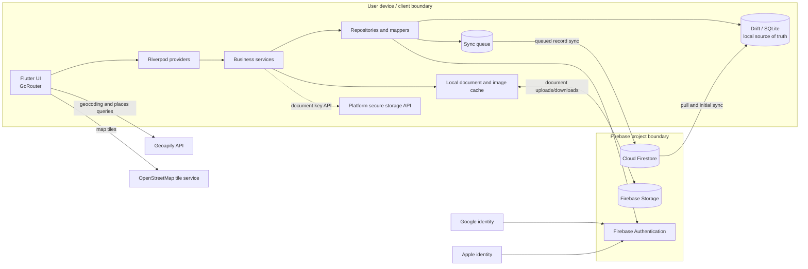

# KoungaTripMate — Application Overview & Security Assessment Brief

**Prepared for:** Cybersecurity Governance Team Lead  
**Purpose:** Technical discovery to support selection of junior security assurance projects  
**Review basis:** Repository inspection only; no runtime testing, cloud console access or production data access  
**Status:** Descriptive brief, not a penetration test, vulnerability assessment, audit or compliance opinion

## 1. Executive Application Overview

| Item | Repository-supported description |
|---|---|
| Application | KoungaTripMate (`pubspec.yaml`, version `2.0.1+15`) |
| Business purpose | Offline-first group travel coordination application developed by Kounga Solutions. |
| Users | Individual travellers and trip groups; users can create or join trips, collaborate on plans and expenses, and manage trip documents. No separate business customer/tenant model is evident. |
| Problems addressed | Coordinating itineraries, accommodation, ideas, attractions, shared costs, settlements, invitations and travel documents across a group, including when connectivity is unavailable. |
| Maturity | Functionally broad client application with numerous implemented screens, services, repositories and schema migrations. Repository evidence alone cannot establish release status, active user base, production operation or operational maturity. README content is stale in places: its “Next Steps” describe components already present. |
| Technology | Flutter/Dart, Riverpod, GoRouter, Drift/SQLite, Firebase Authentication, Cloud Firestore and Firebase Storage; native platform wrappers for Android, iOS, macOS, Windows, Linux and web. |
| Hosting/deployment | Mobile and desktop client build configuration is present. Firebase is the configured cloud backend. No server application, Firebase Functions source, CI/CD workflow, hosting deployment definition, Terraform or other IaC was identified. Actual deployment channels and production settings are unknown. |
| External dependencies | Firebase services; Google and Apple identity providers; Geoapify geocoding and places APIs; OpenStreetMap map tiles (Flutter Map integration); platform file/photo/camera and URL-handling facilities. |

For a governance reviewer: TripMate keeps the primary working copy of trip information on the user's device and queues changes for later synchronisation to Firebase. It supports collaborative travel planning and includes financial records such as expenses and settlements, profile information, location-related travel plans, and document uploads. The repository contains Firebase security rules and a range of client-side security-related code, but the effective controls in a deployed application depend on Firebase project configuration, platform builds, and runtime verification. Document encryption claims need particular care: the inspected upload path sends file bytes as read from the local file, and helper methods labelled encrypt/decrypt are placeholders that return the original bytes.

## 2. Application Functionality

| Feature | Business purpose and user interaction | Backend processing and data | External services |
|---|---|---|---|
| Accounts and profiles | Sign in with Google, Apple or email/password; edit identity/profile preferences. | Firebase Auth establishes identity; local profile is stored in SQLite and user profile data is synchronised to Firestore. Fields include email, display name, profile picture URL, phone number, preferred currency and invite code (`auth_repository_impl.dart`, `users_table.dart`). | Firebase Auth, Google Sign-In, Apple Sign-In |
| Trip planning and membership | Create/join trips, invite travellers, manage members and trip settings. | Trip, member, invite and invitation records are stored locally and queued for Firestore sync. Trip data includes destination, dates, time zone, currency, coordinates and hero image URL. | Firebase Auth, Firestore, Firebase Storage; QR code generation/scanning for join flows |
| Agenda and ideas | Build itinerary items and collaboratively propose/vote on ideas and comments. | Local entities synchronise to trip-scoped Firestore subcollections. Agenda records support visibility fields; ideas have statuses and comments. | Firebase/Firestore |
| Expenses and settlements | Record costs, payers, participants, currencies and payment status; calculate balances. | Expense and participant data plus audit records are stored locally and synchronised. Settlement calculations are performed in `SettlementService`; payment markers are stored. Exchange conversion uses built-in fixed rates or trip custom rates, not a live rate provider (`currency_converter.dart`). | Firebase/Firestore |
| Documents | Upload/view trip documents and manage a personal-document area; link some documents to itinerary/expenses. | Metadata is stored in Drift and Firestore; files use Firebase Storage. Upload UI validates data and compresses some images. Storage paths include trip and personal document namespaces. | Firebase Storage, native file/photo pickers, PDF viewers |
| Accommodation and attractions | Save places/accommodation details; search for points of interest around destination coordinates; display maps. | Accommodation and saved attraction records are local/synchronised; attractions cache locally. Address/place searches call Geoapify with a configured API key. | Geoapify, OpenStreetMap tile service |
| Activity, feedback and diagnostics | View in-app activity notifications, submit feedback/bug reports with optional image attachment, inspect sync failures and diagnostics. | Notifications sync by trip; reports are written to Firestore collections with attachments in Storage. Diagnostic code reads user profile information from Firestore and local DB. | Firebase services |
| Offline synchronisation | Continue using local data offline, then sync queued updates and download/cache document files when online. | Drift is the local source of truth; sync queue and sync engine push/pull data to Firestore (`app_database.dart`, `sync_engine_service.dart`). Conflict handling is implemented in the sync logic; source comments describe last-write-wins in places. | Firebase, connectivity/platform APIs |

## 3. Technical Architecture

**Frontend:** Flutter UI in `lib/ui/screens`, `lib/ui/dialogs` and `lib/ui/widgets`; state management through Riverpod providers; GoRouter handles navigation and sign-in redirects (`lib/router/app_router.dart`).

**Data and backend:** Drift/SQLite schema version 16 (`lib/data/drift/app_database.dart`) is the local source of truth. Repository implementations perform local writes and enqueue sync operations. `SyncEngineService` syncs to/from Firestore. Firebase Authentication is used for sign-in; Firestore holds shared application records; Firebase Storage holds files. No custom server/backend API or cloud function code is present in the inspected repository.

**Storage and integrations:** Native/local files include cached document files and image cache; `flutter_secure_storage` is used for a document-key value. Geoapify API requests include search text or coordinates, radius/category and the API key. Map rendering uses OpenStreetMap tiles. Firebase application configuration exists in platform files; deployment-specific Firebase console settings are not part of the repository evidence.

**Trust boundaries and data flows:** The device boundary includes local SQLite, cached files, application state and platform-protected storage APIs. Synchronisation crosses to Firebase over SDK-managed network connections. Identity assertions come from Firebase Auth and federated providers. Search requests send destination/address or coordinates to Geoapify. Map tile requests disclose tile coordinates to the tile service. Files and selected profile/hero images cross to Firebase Storage. Network transport is SDK/HTTPS based by service convention, but end-to-end runtime transport settings were not verified here.

## 4. Data Classification and Handling

| Data category | Examples and origin | Processing/storage and external transmission |
|---|---|---|
| Identity/profile information | Auth UID, email, display name, profile picture URL, optional phone number and invite code; supplied by user or identity provider. | Firebase Auth and user profile records in Firestore; local Drift profile tables; profile images in Firebase Storage. Auth provider and Firebase processing are involved. |
| Personal and travel information | Trip title, destination, dates/time zone, coordinates, accommodation address/phone/notes, agenda, membership and travel plans. | Local SQLite and trip-scoped Firestore. Destination/address queries can be sent to Geoapify; map coordinates determine OpenStreetMap tile requests. |
| Financial/business information | Expense titles, amounts, currency, payer and participants, settlement status, custom exchange rates, expense audit records. | Local SQLite and Firestore. No payment-card processing integration was identified; settlement records represent user-tracked reimbursement/payment status. |
| Documents and potentially sensitive personal data | User-selected trip or personal files, MIME type, name, size, hash, ownership and optional sensitive flag. Document categories include passport/visa/insurance/ticket/booking; actual files may contain identity/travel data. | Metadata in SQLite/Firestore; file bytes in Firebase Storage and local file cache. Personal document Storage rules scope access to user ID; trip files use trip membership checks in the checked-in rules. Actual uploaded file contents are not encrypted by the active upload path based on code inspection. |
| User-submitted support content | Feedback/bug report title, description, category/rating and optional image attachment. | Firestore report collection and Firebase Storage attachment path. Rules restrict creation to the authenticated user ID and reading to a developer-admin email claim. |
| Operational/application data | Sync queue records, error/sync state, timestamps, app version, notifications, cached images and diagnostic information. | Local SQLite, Firestore notifications and device logs. `AppLogger` logs only in debug mode, but numerous direct `print` calls are present, with many guarded by `kDebugMode`; no central production monitoring integration was identified. |
| Secrets/configuration | Geoapify key loaded from `.env`; Firebase client configuration files; Android signing configuration is referenced by Gradle. | `.env` is ignored by `.gitignore`; `.env.example` is present. Values intentionally not reproduced. Firebase client config and mobile client API keys are configuration artifacts, not proof of secret handling or server-side secrecy. `android/key.properties` exists; its contents are intentionally excluded. |
| AI or payment-card data | No AI/ML API integration or payment-card processing code was identified. | Not identifiable as an application processing flow in this repository. |

**Retention/deletion:** Local logout cleanup clears the Drift database, downloaded document directory, image cache and secure-storage entries (`AuthRepositoryImpl._clearAllLocalData`). Account deletion removes the Firebase Auth user after local cleanup but explicitly leaves Firestore user/trip data for backend handling that is not implemented in this repository. Firestore rules allow soft-delete patterns in several entities, and Storage deletion is allowed for selected paths. No general retention schedule, automated cloud purge or end-to-end deletion workflow is established by repository evidence.

**Data minimisation:** The local-first design and per-user document count/size validation limit some usage. Data minimisation, field-level retention and external-provider privacy settings require further review; no broad privacy inventory or retention policy was identified.

## 5. Existing Security Architecture and Controls

| Security area | Observed implementation | Evidence / source location | Verification status |
|---|---|---|---|
| Identity | Firebase Auth client flows for Google, Apple and email/password; auth state listener; profile mapping to local storage. No MFA flow or MFA enforcement is identifiable. | `lib/data/repositories/auth_repository_impl.dart`; `lib/data/providers/auth_providers.dart`; `lib/ui/screens/login_screen.dart` | Confirmed in source; provider configuration and runtime behavior require verification |
| Session handling | Firebase Auth SDK current-user and auth-state handling; router redirects signed-out users to login. | `auth_repository_impl.dart`; `lib/router/app_router.dart` | Confirmed in source; token/session configuration requires runtime verification |
| Role/authorization | Firestore rules define authenticated users, trip membership and active trip admin helpers; trip-scoped rules differentiate members/admins for selected operations. | `firestore.rules` (`isTripMember`, `isTripAdmin`, `/trips/{tripId}` subcollections) | Confirmed in source; effective deployed rules and rule behavior require runtime verification |
| User profile access | Rules include two separate `/users/{userId}` match blocks; one permits authenticated profile `get`, another permits authenticated profile reads. Firestore rules are additive across matching allow statements. | `firestore.rules` user rules around lines 76 and 416 | Confirmed in source; requires rule-level review and deployed verification |
| Trip access | Trip document read checks creator/member; a separate `allow list: if isAuthenticated()` is present. Trip members can create their own membership document under broad conditions; updates allow own-member changes. | `firestore.rules` trip and members blocks | Confirmed in source; intended query restrictions and effective access need dedicated rules assurance |
| Invites | Invite reads/listing are allowed to any authenticated user; collection-group invite reads also allowed to authenticated users to support code lookup. | `firestore.rules` invite and collection-group rules | Confirmed in source; deployed policy/runtime access unknown |
| Storage access | Personal document paths check owner UID; trip document path checks membership or creator; files have size limits. Other paths include broader authenticated-user write/read rules for profile pictures and trip hero images. | `storage.rules` | Confirmed in source; deployed policy and path usage need verification |
| File content protection | Secure-storage key creation/read exists, but `_encryptFileData` and `_decryptFileData` return input bytes unchanged; inspected upload dialog reads file bytes and uploads them directly. No effective file encryption at application layer is established. | `lib/data/services/document_service.dart`; `lib/ui/dialogs/add_document_dialog.dart` | Confirmed in source |
| Transport | Firebase SDKs and Geoapify requests use service endpoints; Geoapify URL is HTTPS. Platform native networking configuration is present. No custom TLS pinning or certificate policy found. | `geocoding_service.dart`, `attractions_service.dart`, Firebase SDK usage | Configuration-dependent; runtime network behavior not verified |
| Input validation | Client-side document name, size, count checks; Storage rules constrain selected content types/sizes; notification rules validate allowed fields and types. Not all Firestore records have equivalent schema allowlists in rules. | `document_service.dart`, `storage.rules`, `firestore.rules` notification block | Confirmed in source; completeness/effectiveness requires rules review |
| API abuse protection | No application-level rate limiter identified. Geoapify handles 401/429 responses, but that is response handling, not a client-enforced abuse limit. | `geocoding_service.dart`, `attractions_service.dart` | Not identifiable from repository |
| CORS/security headers | No server-rendered web hosting configuration or header policy identified. | `web/`, `firebase.json` | Not identifiable from repository; applicable hosting setup unknown |
| Error handling | Services catch and translate various errors; sync failures are queued/reported in UI. Error messages sometimes include provider messages. | `lib/data/services`; `lib/ui/screens/sync_failures_screen.dart` | Confirmed in source; production exposure needs runtime verification |
| Secrets | `.env` ignored; key read using `flutter_dotenv`; example template contains placeholder. Android signing values are loaded from `key.properties`. | `.gitignore`, `.env.example`, `main.dart`, `repository_providers.dart`, `android/app/build.gradle.kts` | Confirmed in source; actual files and release artifact handling not assessed |
| Cloud IAM/networking | No cloud IAM, VPC/network policy, service account or infrastructure-as-code definitions found. | Repository file inventory; `firebase.json` only references rules | Not identifiable from repository |
| Logging/monitoring | Debug logging helper disables its methods outside debug mode, but direct prints also occur. A TODO references possible future Crashlytics/Sentry; no SDK integration found in dependencies. | `lib/utils/app_logger.dart`; direct prints e.g. sync/auth/services; `pubspec.yaml` | Confirmed in source; production logs and monitoring configuration unknown |
| Auditability | Expense audit log model/table and Firestore append-only rule; comments also have append-only update policy. Other operations are not uniformly covered by a security audit trail. | `lib/data/drift/tables/expense_audit_logs_table.dart`, `firestore.rules` | Confirmed in source; operational audit coverage requires verification |
| Dependency management | Exact resolved dependency versions recorded in `pubspec.lock`; version constraints in `pubspec.yaml`. No dependency scanner configuration or automated update workflow found. | `pubspec.yaml`, `pubspec.lock`, repository inventory | Confirmed in source for lockfile; scanning/update process not identifiable |
| Security testing/CI | Unit/widget tests cover auth, sync, settlement, agenda/ideas and edge cases; no Firebase rules tests, security scanning, CI workflow, or release security checks identified. Some test files are disabled. | `test/`; no `.github` workflow found | Confirmed in source for tests; process and CI unknown |
| Platform hardening | Platform project files define app IDs, permissions/entitlements and release signing references. No repository evidence establishes production signing key custody, obfuscation, mobile threat defense or web CSP/headers. | `android/app/build.gradle.kts`, `ios/Runner/Info.plist`, platform directories | Configuration-dependent |

## 6. Current Security Development Practices

**Supported by repository evidence:** the project uses Dart static analysis configuration with Flutter lints; code is layered into models, repositories, services and providers; it has unit/widget tests for selected business behavior; there are Firestore and Storage rules checked into source; dependency versions are locked; `.env` is excluded from Git; some local input checks and error handling are implemented.

**Not evidenced:** formal security requirements or acceptance criteria, mandatory peer review, threat modelling, secure design reviews, automated SAST/DAST/dependency scanning, Firebase Rules emulator tests, CI/CD gates, release approval checks, vulnerability intake/remediation SLA, security incident response exercises, risk acceptance process, supplier assurance, or a maintained security control register. These processes may exist outside the repository and should be treated as unknown rather than absent.

README documentation describes architecture but is not fully current: its listed future packs overlap with implemented code, and its declared Firebase dependency versions differ from the current `pubspec.yaml`. Repository inspection therefore prioritised code and current configuration over README statements.

## 7. Security Assurance Coverage and Unknowns

**Implementation evidence exists** for client authentication flows, local-first data storage, queued synchronisation, Firebase rule files, scoped Storage paths, local cleanup, selected validation, dependency lockfile, and selected functional tests.

**Requires verification** for deployed Firestore/Storage rules, Firebase Auth provider and MFA settings, cloud project IAM and logging, production data location/backup/retention, network configurations, Android/iOS release signing and entitlements, Geoapify account restrictions, user deletion behavior, actual document handling and log collection.

**Documentation is incomplete or stale** for deployment topology, environment separation, operational ownership, release process, security requirements, privacy/retention, threat model, incident response and third-party assurance.

Potential investigation areas for a future analyst include: whether the rule design matches intended access boundaries; how local data and cached files are protected on each platform; how document metadata and file contents are treated across upload/download; how identity lifecycle and account deletion map to remote records; what telemetry captures in release builds; and how external API keys/quotas are constrained. These are inquiry topics, not findings or compliance conclusions.

## 8. Potential Practical Assessment Areas

| Assessment topic | Why it is relevant | Available evidence | Potential learning outcomes |
|---|---|---|---|
| Firebase authorization assurance | Firestore rules implement trip, member, invite and profile access boundaries. | `firestore.rules`, repository sync queries and membership services | Map roles to data actions; review rule semantics; design emulator-based positive/negative authorization tests. |
| Storage and document data protection | App handles trip/personal travel documents and files with sensitive potential; encryption helper is a placeholder. | `document_service.dart`, upload dialog, `document_download_service.dart`, `storage.rules` | Trace a data lifecycle; distinguish metadata protection, access control and encryption; document assumptions for cloud and device storage. |
| Identity lifecycle and account deletion | Multiple sign-in methods and local cleanup exist; remote data is explicitly retained pending backend handling. | `auth_repository_impl.dart`, auth providers, user rules | Build identity/data lifecycle map; examine reauthentication, federated sign-in and deletion ownership. |
| Privacy and data-flow assessment | Profiles, travel plans, coordinates, expenses and documents cross local/cloud/provider boundaries. | Drift tables, Geoapify services, Firebase integrations, platform permissions | Create a data inventory and flow diagram; assess minimisation and external disclosure questions. |
| Secure SDLC evidence review | Tests/lints/lockfile exist, while security automation/process evidence is limited. | `test/`, `analysis_options.yaml`, `pubspec.lock`, repository workflow inventory | Separate engineering evidence from governance claims; propose evidence collection for code review, scanning and release gates. |
| Logging and operational monitoring review | Sync/auth code emits diagnostics, and crash reporting appears as a TODO. | `app_logger.dart`, `sync_engine_service.dart`, direct debug logging | Identify event types and potential sensitive fields; formulate monitoring/evidence questions without asserting production exposure. |
| Third-party service and API key governance | Geoapify receives location/search inputs; mobile configuration handles an API key. | `.env.example`, `repository_providers.dart`, Geoapify service classes, dependency list | Map provider data, account controls, key restrictions, quotas and contractual/privacy evidence. |
| Cloud governance and environment assurance | Firebase is central, but infrastructure and project configuration are not described in repository. | `firebase.json`, rules files, platform Firebase options | Create a cloud evidence request list covering IAM, environment separation, backups, logs and deployment ownership. |

## 9. Known Limitations of This Review

This review inspected repository content only. It did not inspect a running client, perform dynamic tests, execute test suites, query Firebase, access production data, review cloud consoles or validate the compiled release artifact. Therefore it cannot establish:

- Which Firebase project/environment is live, or whether checked-in rules are deployed.
- Effective Firebase IAM, Auth provider/MFA configuration, billing controls, backups, retention, region, monitoring or incident alerts.
- Infrastructure or network controls managed outside the repository.
- Actual app distribution, release signing key custody, build provenance, version rollout or platform-specific production settings.
- Contracts, privacy terms, data-processing agreements or assurance reports for Firebase, Google, Apple, Geoapify or map tile providers.
- Whether external processes exist for code review, risk acceptance, incident response, vulnerability handling or access reviews.
- Runtime log contents, user consent and privacy notices, or real-world deletion outcomes.
- Effectiveness of controls through adversarial or functional testing.

## 10. Mentor's Quick Reference

| Quick reference | Summary |
|---|---|
| Purpose | Offline-first group travel planning and shared expense coordination. |
| Stack | Flutter/Dart, Riverpod, GoRouter, Drift/SQLite, Firebase Auth, Firestore, Firebase Storage; Geoapify and OpenStreetMap integration. |
| Architecture complexity | **Medium.** Single mobile/client codebase with multiple platform targets, a local-first sync engine, Firebase rules/storage, and external location services; no custom server or event platform found. |
| Information processed | Identity/profile data; trip destinations, dates, coordinates and itinerary; accommodation details; expenses and settlements; travel documents; support reports; sync/diagnostic records. |
| Main control areas | Firebase identity and rules; device/local data protection; file handling; sync consistency; external API governance; logging and lifecycle/deletion. |
| Best-fit assurance domains | Application security assurance, privacy/data-flow review, cloud governance evidence review, secure SDLC maturity, third-party provider assessment. |
| Beginner-friendly assignments | Draw data-flow and trust-boundary diagrams; map Firestore roles to allowed actions; inventory data fields and retention evidence; review dependency/security process evidence; create a non-invasive cloud configuration evidence checklist. |
| Needs deeper technical guidance | Firebase Security Rules semantics and emulator testing; mobile secure storage and file cryptography; offline sync consistency; Firebase IAM/deployment; platform-specific release security. |
| Key evidence gaps | No IaC or CI/CD security workflow; no documented threat model or retention schedule; no identified rules tests; no repository evidence for production Firebase settings, operational monitoring or formal governance process. |

---

### Evidence index

Primary files reviewed include `pubspec.yaml`, `pubspec.lock`, `README.md`, `requirements.md`, `firebase.json`, `firestore.rules`, `storage.rules`, `firestore.indexes.json`, `lib/main.dart`, `lib/router/app_router.dart`, `lib/data/drift/app_database.dart`, `lib/data/drift/tables/`, `lib/data/repositories/auth_repository_impl.dart`, `lib/data/repositories/document_repository_impl.dart`, `lib/data/services/`, `lib/ui/dialogs/add_document_dialog.dart`, `lib/data/providers/repository_providers.dart`, `lib/utils/app_logger.dart`, `android/app/build.gradle.kts`, `ios/Runner/Info.plist`, `.gitignore`, `.env.example` and selected files under `test/`.

Sensitive values in environment, platform Firebase configuration and signing-related files were not copied into this document. No application code or configuration was modified.
